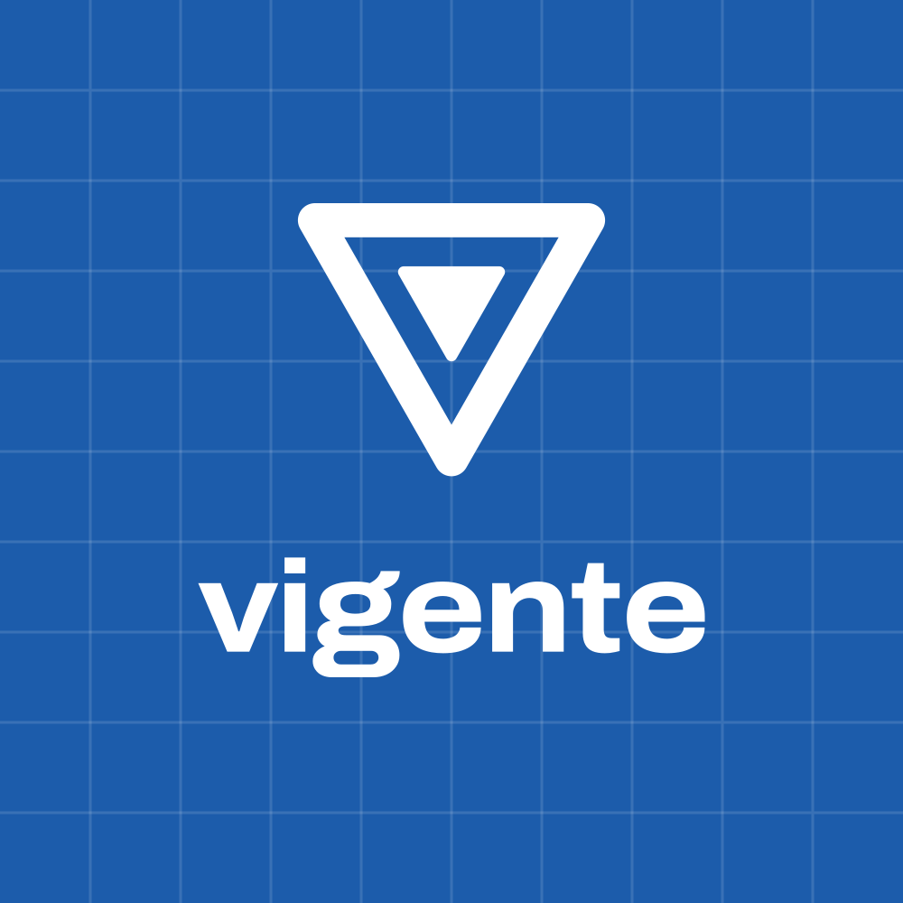

# team-27 Platanus Hack 26: Santiago ft. Buk Project



Track: 🔗 Multiplayer

**Vigente convierte cada cambio de un proyecto de construcción en acción coordinada, antes de que sus consecuencias se propaguen.**

## Problema

En construcción, muchos equipos toman decisiones interdependientes con herramientas, documentos y modelos distintos. Cuando alguien cambia una decisión, un elemento o una especificación, los equipos que dependen de eso no siempre se enteran a tiempo de cómo los afecta. Detectarlo depende de revisiones y comunicación manual, y la información desactualizada sigue avanzando: retrabajo, conflictos entre disciplinas, retrasos y sobrecostos.

## Solución

Nos conectamos al software que el proyecto ya usa (BIM, planificación, costos, gestión documental) y capturamos cada cambio apenas ocurre. Identificamos qué elementos, decisiones y equipos quedan afectados, y a cada uno le llevamos solo lo que le impacta (resumen, impacto estimado en costo y plazo, enlace al detalle) al canal donde ya trabaja: correo, Slack/Teams, WhatsApp o su propia herramienta. Sin reemplazar herramientas ni centralizar datos.

Actores, historias de usuario y glosario: [docs/negocio.md](docs/negocio.md).

## Equipo

- José Carter ([@Cartterr](https://github.com/Cartterr))
- Cristofer Oyarzo ([@crystof-create](https://github.com/crystof-create))
- Orlando Sebastian Avendaño Quilapan ([@sebaav12](https://github.com/sebaav12))
- Pedro Pablo Palma Villanueva ([@pedropalmav](https://github.com/pedropalmav))
- Agustin Rios ([@agustin-rios](https://github.com/agustin-rios))

## Desarrollo

```bash
nvm use && corepack enable   # Node 24 y pnpm 10.33
pnpm install
pnpm dev                     # http://localhost:3000
pnpm check                   # lint, test, typecheck y build
```

[Arquitectura](docs/arquitectura.md) · [Despliegue](docs/despliegue.md)
