# Negocio

Coordinamos los cambios de un proyecto de construcción entre los equipos que dependen de ellos. Este doc es la fuente del problema, la propuesta, los actores y el lenguaje del dominio: los nombres del código salen del [glosario](#glosario).

## Problema

En proyectos de construcción, múltiples equipos toman decisiones interdependientes mientras trabajan con distintas herramientas, documentos y modelos. Cuando un actor modifica una decisión, elemento, especificación o condición del proyecto, los equipos que dependen de ese cambio no siempre pueden identificar a tiempo cómo los afecta ni qué deben actualizar.

Como estas dependencias están distribuidas entre personas y sistemas, detectar el impacto y coordinar una respuesta depende de revisión, interpretación y comunicación manual entre equipos. Esto hace que información desactualizada siga avanzando por el proyecto y termine generando retrabajo, conflictos entre disciplinas, retrasos y sobrecostos.

## Propuesta de valor

Convertimos el efecto de cada cambio en una respuesta coordinada antes de que afecte decisiones, costos o plazos.

La solución identifica qué elementos, decisiones y equipos quedan afectados, determina qué necesita saber cada actor y lleva esa información directamente a las herramientas donde ya trabaja. Así, los equipos reaccionan sobre el impacto real del cambio en lugar de descubrirlo después en reuniones, revisiones manuales o conflictos, sin reemplazar su software ni centralizar sus datos en una nueva plataforma.

## Principios

- **No reemplaza herramientas.** Se conecta a los espacios donde ya vive la información del proyecto: el Drive, las planillas, el correo, el WhatsApp de la obra, el libro de obra y el modelo BIM.
- **Consolidar no es centralizar.** Nadie migra su información. Leemos cada documento donde vive y guardamos por detrás sus hechos, con un puntero al origen: no los archivos.
- **Nadie reporta cambios a mano.** El cambio se captura en el documento donde ocurre: una revisión nueva de un plano, una cotización o un mensaje.
- **Lo vigente es un consenso.** El valor vigente cambia solo cuando todos los afectados lo confirman. Una disputa no lo borra.
- **La autoridad es explícita.** El plano y la EETT mandan sobre el diseño, la cotización y el presupuesto sobre el precio, y la Carta Gantt y el acta sobre las fechas. Un WhatsApp o el libro de obra proponen, pero no deciden.
- **Cada valor sabe de dónde viene.** Revisión, espacio, autor y quién lo confirmó.
- **Solo lo que impacta.** Cada afectado recibe lo suyo; el ruido hace que los avisos se ignoren. Quien queda fuera ve por qué.
- **En el canal que ya se usa.** Correo, Slack/Teams, WhatsApp o la propia herramienta.

## Flujo

```mermaid
flowchart LR
  autor["Autor del cambio"] --> sw["Documentos en sus espacios<br/>planos, cotizaciones, Gantt,<br/>actas, WhatsApp, libro de obra"]
  sw -->|captura automática| lago["Lago de hechos<br/>contra lo vigente"]
  lago -->|diferencia con autoridad| cambio["Cambio propuesto"]
  cambio --> impacto["Impacto<br/>elementos, decisiones y equipos;<br/>costo y plazo estimados"]
  impacto -->|solo lo relevante| notif["Notificación<br/>resumen, impacto y enlace"]
  notif --> canal["Canal del afectado<br/>correo, Slack/Teams,<br/>WhatsApp, su herramienta"]
  canal --> afectado["Afectado"]
  afectado -->|revisado o tengo un problema| respuesta["Respuesta"]
  respuesta -->|todos confirman| lago
  respuesta --> autor

  classDef actor fill:#E7F5FF,stroke:#1C7ED6,color:#0B3D6B
  classDef domain fill:#E6FCF5,stroke:#12B886,color:#0B3D2E
  classDef external fill:#F3F0FF,stroke:#7048E8,color:#2E1A6B
  class autor,afectado actor
  class lago,cambio,impacto,notif,respuesta domain
  class sw,canal external
```

El impacto se decide con reglas sobre el grafo del proyecto, no a criterio:

- **Dependencias.** Quien depende de una propiedad de un tipo de elemento se entera cuando esa propiedad cambia. Por ejemplo, la calculista depende del espesor de las losas.
- **Costo.** Lo que cambia la cantidad de cada partida, multiplicado por su precio unitario. Si el total cambia, se entera quien lleva el presupuesto.
- **Plazo.** Lo que cambia la duración de las tareas que dependen de esa cantidad, recorrido por la ruta crítica. Quien lleva el plazo se entera solo si la entrega se mueve; si la holgura absorbe el cambio, no se le avisa y queda registrada la razón.

Cómo se decide qué es un cambio y cuándo pasa a lo vigente (autoridad, discrepancias, consenso, desfases y procedencia) está en [motor](motor.md#el-lago-y-el-consenso).

## Actores

| Actor            | Quién es                                                                       | Qué espera                                                      |
| ---------------- | ------------------------------------------------------------------------------ | --------------------------------------------------------------- |
| Administrador    | Quien configura el proyecto y sus integraciones                                | Conectar el software una vez y no cargar cambios a mano         |
| Autor del cambio | Quien modifica una decisión, elemento, especificación o condición del proyecto | Seguir trabajando en su software, sin reportar lo que cambió    |
| Afectado         | El equipo o la persona cuyo trabajo depende de lo que cambió                   | Enterarse a tiempo, solo de lo que le impacta, donde ya trabaja |

Una misma persona puede ser autor de un cambio y afectada por otro.

## Historias de usuario

- **HU-01 · Administrador.** Quiero conectar los software del proyecto (modelado/BIM, planificación, costos, gestión documental) para que los cambios se capturen sin carga manual.
- **HU-02 · Autor del cambio.** Quiero que el sistema detecte el cambio apenas ocurre en mi software, sin tener que reportarlo yo.
- **HU-03 · Afectado.** Quiero recibir solo los cambios que realmente me impactan, para no ignorar avisos por exceso de ruido.
- **HU-04 · Afectado.** Quiero recibir la notificación en la plataforma que ya uso (correo, Slack/Teams, WhatsApp, la propia herramienta) para enterarme a tiempo.
- **HU-05 · Afectado.** Quiero que la notificación incluya el resumen del cambio, el impacto estimado en costo/plazo y un enlace al detalle.
- **HU-06 · Afectado.** Quiero responder desde mi canal si el cambio está revisado o si me complica, para que el autor lo sepa sin una reunión.
- **HU-07 · Autor del cambio.** Quiero ver a quién le llegó mi cambio, quién lo revisó y quién tiene un problema, para coordinar sin perseguir a nadie.
- **HU-08 · Equipo.** Quiero que lo vigente cambie solo cuando todos los afectados lo confirman, para que nadie avance con un valor que otro todavía disputa.
- **HU-09 · Dueño de un valor.** Quiero que un mensaje o un folio que contradice un valor me avise a mí sin cambiar nada, hasta que un documento con autoridad lo respalde.
- **HU-10 · Dueño de un documento.** Quiero saber cuándo mi documento quedó desfasado respecto de lo vigente, para actualizarlo o confirmar que no cambia.
- **HU-11 · Cualquiera del equipo.** Quiero tocar un valor del proyecto y ver de dónde salió, quién lo afirmó y quién lo confirmó.

## Glosario

| Término             | En el código           | Qué es                                                                                                                                                                         |
| ------------------- | ---------------------- | ------------------------------------------------------------------------------------------------------------------------------------------------------------------------------ |
| Proyecto            | `Project`              | La obra: los equipos, su software y las dependencias entre ellos                                                                                                               |
| Integración         | `Integration`          | La conexión con un software del proyecto (BIM, planificación, costos, gestión documental)                                                                                      |
| Espacio             | `Space`                | Lugar donde ya vive la información: Drive, planillas de costos, correo, WhatsApp, libro de obra; tiene un dueño                                                                |
| Documento           | `documentId`           | Artefacto de identidad estable: plano, EETT, presupuesto, Carta Gantt, cotización, acta, mensaje, folio                                                                        |
| Revisión            | `Revision`             | Versión inmutable de un documento, con espacio, autor, fecha, hash y puntero al origen                                                                                         |
| Fragmento           | `Chunk`                | La parte de una revisión que se compara por separado: una fila, un mensaje, un acuerdo, un parámetro de Revit                                                                  |
| Hecho               | `Claim`                | Lo que un fragmento afirma (o usa) sobre una propiedad de un elemento, con su localizador de origen y su confianza                                                             |
| Lo vigente          | `BaselineEntry`        | El valor consolidado y consensuado de una propiedad, con su procedencia e historial                                                                                            |
| Cambio              | `Change`               | Una modificación de una decisión, elemento, especificación o condición, capturada en el documento de origen                                                                    |
| Propuesta           | `Proposal`             | El PR de la obra: una por revisión con autoridad que cambia algo, con un hunk por cambio; pasa a lo vigente cuando todos sus revisores aprueban y no tiene solapamientos vivos |
| Área                | `AreaCell`             | Nivel, celda de la grilla de ejes y sistemas: dónde está algo en la obra                                                                                                       |
| Huella              | `footprint`            | Las áreas que ocupa un elemento según sus valores vigentes o propuestos                                                                                                        |
| Solapamiento        | `Overlap`              | Un fragmento que toca el mismo elemento o la misma área que otro documento o que otra propuesta                                                                                |
| Validación conjunta | `Overlap.votes`        | La decisión de los dueños de ambos lados de un solapamiento: se tocan o no se tocan; mientras no se resuelva, la propuesta no entra                                            |
| Discrepancia        | `Discrepancy`          | Un valor distinto de lo vigente que viene de una fuente sin autoridad; avisa solo al dueño del valor                                                                           |
| Desfase             | `StaleDocument`        | Un documento vigente que dice o usa un valor distinto de lo vigente                                                                                                            |
| Procedencia         | `Provenance`           | La cadena que responde de dónde salió un valor: revisión, espacio, autor, propuesta y aprobaciones                                                                             |
| Consenso            | `ConsensusIndex`       | Documentos al día sobre documentos totales; al completarse, la obra queda consensuada                                                                                          |
| Dependencia         | `Dependency`           | La relación por la que el trabajo de un equipo depende de un elemento o una decisión de otro                                                                                   |
| Partida             | `BudgetItem`           | Una línea del presupuesto: cantidad de un tipo de elemento por un precio unitario                                                                                              |
| Tarea               | `Task`                 | Una faena del plan, con su duración y las tareas que deben terminar antes                                                                                                      |
| Holgura             | `floatDays`            | Los días que una tarea puede atrasarse sin mover la entrega; en la ruta crítica es cero                                                                                        |
| Impacto             | `Impact`               | Lo que un cambio afecta: elementos, decisiones y equipos, con su costo y plazo estimados                                                                                       |
| Hallazgo            | `Finding`              | Lo que un impacto significa para un afectado: qué le cambia, sus números y qué debería hacer                                                                                   |
| Afectado            | `Stakeholder`          | Un equipo o persona alcanzada por el impacto de un cambio                                                                                                                      |
| Canal               | `Channel`              | Donde el afectado recibe la notificación: correo, Slack/Teams, WhatsApp o la propia herramienta                                                                                |
| Notificación        | `Notification`         | El aviso a un afectado: resumen del cambio, impacto estimado en costo y plazo, y enlace al detalle                                                                             |
| Respuesta           | `NotificationResponse` | Lo que el afectado contesta a una notificación: revisado o tengo un problema, con una nota opcional                                                                            |

## Mano alzada

> El sistema calcula quién depende de un cambio. Si falta alguien, la persona afectada alza la mano con su nombre y su hora, y el costo se recalcula. Lo vigente cambia solo cuando confirman todos los que dependen de ello, y callar no aprueba nada: se ve.

Hoy el alcance de un cambio lo fija el autor (la lista de distribución del transmittal o de la orden de cambio) o un grafo que nadie puede corregir con su nombre, y quien no figura no se entera. En Mano alzada, el alcance es lo que calculan las reglas más lo que cualquier persona de la obra declare, con autor y hora.

De esto, el código tiene la capa de probabilidad de [`context/impact`](../context/impact/README.md#probabilidad): `SuggestAffected` estima quién más puede estar afectado y `ExtractClaims` lee qué afirma un documento. La declaración, su validación, la ronda 2 y el silencio visible no están construidos.

### Cómo funciona

1. **Cambio.** Una revisión cambia un valor, por ejemplo el espesor de una losa de 15 a 20 cm. Las reglas avisan a quienes dependen de ese valor, con su costo y su plazo.
2. **Pregunta.** A quien las reglas no ven, pero puede depender del cambio, le llega una pregunta de sí o no, por ejemplo «¿tus canalizaciones van embutidas en esta losa?».
3. **Declaración.** «Me afecta» entra al lago como un hecho «usa», con autor, hora y estado: sin validar, validada o rechazada con nota.
4. **Validación con plazo.** Quien valida acepta o rechaza con nota visible dentro de un plazo. Si calla, la declaración entra igual, rotulada «sin validar».
5. **Ronda 2.** La propuesta reabre con quien declaró como revisor, y todos los votos se reinician.
6. **Costo con origen.** El costo se recalcula y cada cifra lleva su rótulo: «por reglas», «declarada» o «sin validar». Lo que no está en el catálogo entra «por estimar» y no mueve la cifra.
7. **Silencio visible.** Al vencer el plazo, quien no respondió queda «sin respuesta», con nombre y hora; su silencio no aprueba ni fusiona.
8. **Registro de proceso.** Cada cifra muestra quién declaró, quién validó y quién calló.

### Reglas

- El alcance es lo calculado por reglas más lo declarado por cualquier persona; nunca lo elige solo el autor.
- Una declaración sin validar entra al alcance con voto, rotulada. Si quien valida rechaza con nota, la declaración queda visible y el declarante pasa a observador, con derecho a disputar la nota.
- Una declaración que cambia el alcance abre la ronda 2 y reinicia todos los votos.
- El silencio nunca aprueba ni fusiona.
- Las cifras salen de reglas deterministas, sin modelo de lenguaje.
- El registro anota proceso, no culpa.

### Roles

| Rol                                 | Qué aporta                                                    | Qué no puede                       |
| ----------------------------------- | ------------------------------------------------------------- | ---------------------------------- |
| Autor del cambio                    | Sube la revisión                                              | Ver lo que solo sabe quien declara |
| Quien valida                        | Valida o rechaza con nota, dentro de un plazo                 | Controlar el alcance por omisión   |
| Declarantes (cualquier persona)     | Saben lo que las reglas no saben; alzan la mano con su nombre | Fijar el costo o el alcance final  |
| Revisores (por reglas o declarados) | Confirman o disputan                                          | Fusionar sin los demás             |

## Modelo de negocio

Todavía no está definido. Falta decidir:

- **Cliente:** quién compra y quién usa (pueden no ser el mismo).
- **Precio:** cómo se cobra.
- **Canal de venta:** cómo llegamos a los primeros clientes.
