# Negocio

Coordinamos los cambios de un proyecto de construcción entre los equipos que dependen de ellos. Este doc es la fuente del problema, la propuesta, los actores y el lenguaje del dominio: los nombres del código salen del [glosario](#glosario).

## Problema

En proyectos de construcción, múltiples equipos toman decisiones interdependientes mientras trabajan con distintas herramientas, documentos y modelos. Cuando un actor modifica una decisión, elemento, especificación o condición del proyecto, los equipos que dependen de ese cambio no siempre pueden identificar a tiempo cómo los afecta ni qué deben actualizar.

Como estas dependencias están distribuidas entre personas y sistemas, detectar el impacto y coordinar una respuesta depende de revisión, interpretación y comunicación manual entre equipos. Esto hace que información desactualizada siga avanzando por el proyecto y termine generando retrabajo, conflictos entre disciplinas, retrasos y sobrecostos.

## Propuesta de valor

Convertimos cada cambio del proyecto en acción coordinada antes de que sus consecuencias se propaguen.

La solución identifica qué elementos, decisiones y equipos quedan afectados, determina qué necesita saber cada actor y lleva esa información directamente a las herramientas donde ya trabaja. Así, los equipos reaccionan sobre el impacto real del cambio en lugar de descubrirlo después en reuniones, revisiones manuales o conflictos, sin reemplazar su software ni centralizar sus datos en una nueva plataforma.

## Principios

- **No reemplaza herramientas.** Se conecta al software que el proyecto ya usa.
- **No centraliza datos.** Nadie migra su información a una plataforma nueva.
- **Nadie reporta cambios a mano.** El cambio se captura en el software donde ocurre.
- **Solo lo que impacta.** Cada afectado recibe lo suyo; el ruido hace que los avisos se ignoren.
- **En el canal que ya se usa.** Correo, Slack/Teams, WhatsApp o la propia herramienta.

## Flujo

```mermaid
flowchart LR
  autor["Autor del cambio"] --> sw["Software del proyecto<br/>BIM, planificación, costos,<br/>gestión documental"]
  sw -->|captura automática| cambio["Cambio"]
  cambio --> impacto["Impacto<br/>elementos, decisiones y equipos;<br/>costo y plazo estimados"]
  impacto -->|solo lo relevante| notif["Notificación<br/>resumen, impacto y enlace"]
  notif --> canal["Canal del afectado<br/>correo, Slack/Teams,<br/>WhatsApp, su herramienta"]
  canal --> afectado["Afectado"]
  afectado -->|revisado o tengo un problema| respuesta["Respuesta"]
  respuesta --> autor

  classDef actor fill:#E7F5FF,stroke:#1C7ED6,color:#0B3D6B
  classDef domain fill:#E6FCF5,stroke:#12B886,color:#0B3D2E
  classDef external fill:#F3F0FF,stroke:#7048E8,color:#2E1A6B
  class autor,afectado actor
  class cambio,impacto,notif,respuesta domain
  class sw,canal external
```

El impacto se decide con reglas sobre el grafo del proyecto, no a criterio:

- **Dependencias.** Quien depende de una propiedad de un tipo de elemento se entera cuando esa propiedad cambia. Por ejemplo, la calculista depende del espesor de las losas.
- **Costo.** Lo que cambia la cantidad de cada partida, multiplicado por su precio unitario. Si el total cambia, se entera quien lleva el presupuesto.
- **Plazo.** Lo que cambia la duración de las tareas que dependen de esa cantidad, recorrido por la ruta crítica. Quien lleva el plazo se entera solo si la entrega se mueve; si la holgura absorbe el cambio, no se le avisa y queda registrada la razón.

La muestra que presentamos aplica este flujo a un proyecto ficticio: [la muestra](muestra.md).

## Actores

| Actor            | Quién es                                                                       | Qué espera                                                      |
| ---------------- | ------------------------------------------------------------------------------ | --------------------------------------------------------------- |
| Administrador    | Quien configura el proyecto y sus integraciones                                | Conectar el software una vez y no cargar cambios a mano         |
| Autor del cambio | Quien modifica una decisión, elemento, especificación o condición del proyecto | Seguir trabajando en su software, sin reportar lo que cambió    |
| Afectado         | El equipo o la persona cuyo trabajo depende de lo que cambió                   | Enterarse a tiempo, solo de lo que le impacta, donde ya trabaja |

Una misma persona puede ser autor de un cambio y afectada por otro.

## Historias de usuario

- **HU-01 · Administrador.** Quiero conectar los software del proyecto (modelado/BIM, planificación, costos, gestión documental) para que los cambios se capturen sin carga manual.
- **HU-02 · Autor del cambio.** Quiero que el sistema detecte el cambio apenas ocurre en mi software, sin tener que reportarlo yo.
- **HU-03 · Afectado.** Quiero recibir solo los cambios que realmente me impactan, para no ignorar avisos por exceso de ruido.
- **HU-04 · Afectado.** Quiero recibir la notificación en la plataforma que ya uso (correo, Slack/Teams, WhatsApp, la propia herramienta) para enterarme a tiempo.
- **HU-05 · Afectado.** Quiero que la notificación incluya el resumen del cambio, el impacto estimado en costo/plazo y un enlace al detalle.
- **HU-06 · Afectado.** Quiero responder desde mi canal si el cambio está revisado o si me complica, para que el autor lo sepa sin una reunión.
- **HU-07 · Autor del cambio.** Quiero ver a quién le llegó mi cambio, quién lo revisó y quién tiene un problema, para coordinar sin perseguir a nadie.

## Glosario

| Término      | En el código           | Qué es                                                                                                     |
| ------------ | ---------------------- | ---------------------------------------------------------------------------------------------------------- |
| Proyecto     | `Project`              | La obra: los equipos, su software y las dependencias entre ellos                                           |
| Integración  | `Integration`          | La conexión con un software del proyecto (BIM, planificación, costos, gestión documental)                  |
| Versión      | `Snapshot`             | El estado del modelo que publica el software de origen; un cambio es la diferencia entre dos versiones     |
| Cambio       | `Change`               | Una modificación de una decisión, elemento, especificación o condición, capturada en el software de origen |
| Dependencia  | `Dependency`           | La relación por la que el trabajo de un equipo depende de un elemento o una decisión de otro               |
| Partida      | `BudgetItem`           | Una línea del presupuesto: cantidad de un tipo de elemento por un precio unitario                          |
| Tarea        | `Task`                 | Una faena del plan, con su duración y las tareas que deben terminar antes                                  |
| Holgura      | `floatDays`            | Los días que una tarea puede atrasarse sin mover la entrega; en la ruta crítica es cero                    |
| Impacto      | `Impact`               | Lo que un cambio afecta: elementos, decisiones y equipos, con su costo y plazo estimados                   |
| Hallazgo     | `Finding`              | Lo que un impacto significa para un afectado: qué le cambia, sus números y qué debería hacer               |
| Afectado     | `Stakeholder`          | Un equipo o persona alcanzada por el impacto de un cambio                                                  |
| Canal        | `Channel`              | Donde el afectado recibe la notificación: correo, Slack/Teams, WhatsApp o la propia herramienta            |
| Notificación | `Notification`         | El aviso a un afectado: resumen del cambio, impacto estimado en costo y plazo, y enlace al detalle         |
| Respuesta    | `NotificationResponse` | Lo que el afectado contesta a una notificación: revisado o tengo un problema, con una nota opcional        |

## Modelo de negocio

Todavía no está definido. Falta decidir:

- **Cliente:** quién compra y quién usa (pueden no ser el mismo).
- **Precio:** cómo se cobra.
- **Canal de venta:** cómo llegamos a los primeros clientes.
