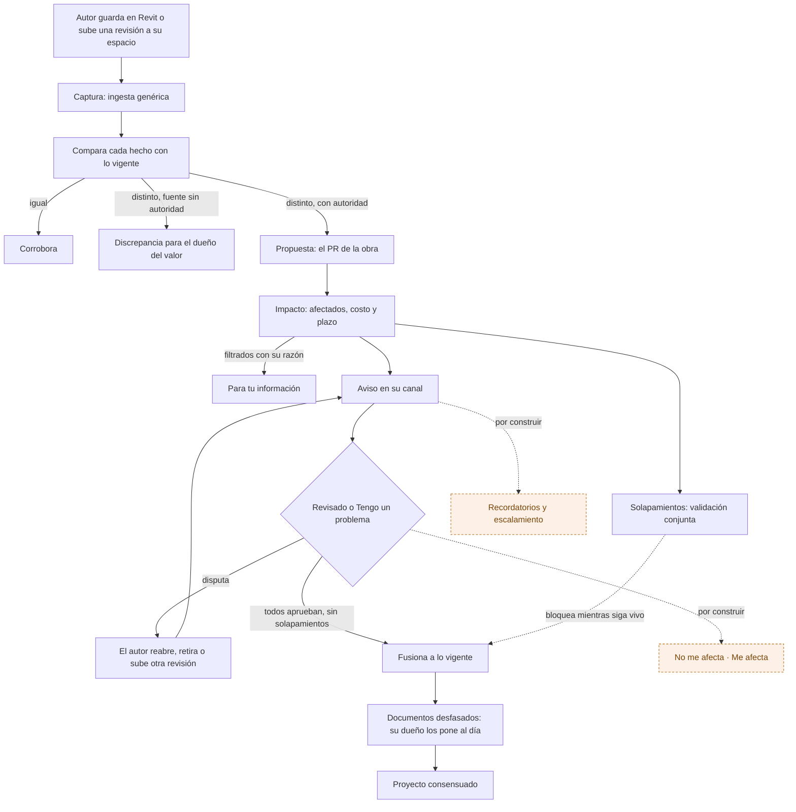
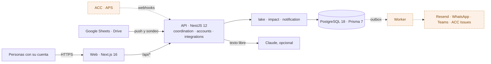

# Spec de Vigente

Esta carpeta junta en un solo lugar qué es Vigente, qué está construido y cómo se compara con el plan. Todo lo que falta se construye sobre el stack actual. Tiene tres lecturas y dos diagramas:

| Archivo                                      | Para quién          | Qué trae                                                                                                                 |
| -------------------------------------------- | ------------------- | ------------------------------------------------------------------------------------------------------------------------ |
| [README.md](README.md)                       | El equipo           | La síntesis, dónde entra en una obra con BIM, el flujo, la arquitectura y el contraste con el plan                       |
| [ia.md](ia.md)                               | Un agente de código | Invariantes, mapa del código, la cadena de un cambio, cada tarea con su evidencia y recetas para construir               |
| [cambios-autodesk.md](cambios-autodesk.md)   | El equipo           | Todo lo que puede cambiar en Autodesk, por dónde se entera Vigente, cómo lo traduce y el spike de AEC Data Model         |
| [flujo-usuario.drawio](flujo-usuario.drawio) | Todos               | El flujo de usuario de un cambio, desde que el autor guarda hasta «Obra consensuada»                                     |
| [arquitectura.drawio](arquitectura.drawio)   | Todos               | La arquitectura de software, con lo construido y lo que falta                                                            |

Los `.drawio` se abren en [draw.io](https://app.diagrams.net) o con la extensión de draw.io para VS Code. En los dos, el verde lleno está construido y el naranjo punteado no existe en el código.

## En una página

- **Problema.** En una obra, muchos equipos toman decisiones interdependientes con herramientas distintas. Cuando alguien cambia algo, quienes dependen de eso no se enteran a tiempo, y la información desactualizada sigue avanzando: retrabajo, conflictos, atrasos y sobrecostos. La fuente es [negocio](../negocio.md#problema).
- **Propuesta de valor.** Convertimos el efecto de cada cambio en una respuesta coordinada antes de que afecte decisiones, costos o plazos ([negocio](../negocio.md#propuesta-de-valor)).
- **Solución.** Nos conectamos al software que el proyecto ya usa, capturamos cada cambio apenas ocurre, calculamos a quién afecta y con qué costo y plazo, y se lo llevamos a cada afectado en su canal. No reemplazamos herramientas ni centralizamos archivos.
- **La tesis del código** va más allá de avisar. Cada revisión de un documento es un PR contra **lo vigente**, la versión consensuada del proyecto: lo vigente cambia solo cuando confirman todos los afectados, y cada valor sabe de dónde salió ([solapamientos](../solapamientos.md), [motor](../motor.md)).
- **Lo que hay hoy** es la app que se va a poblar con datos reales, sin proyecto ficticio: cuentas con Auth0 (por invitación, con superadmins), organizaciones y proyectos, el motor por proyecto, la conexión de una organización con Autodesk, un receptor de los webhooks de Autodesk que deja cada aviso en el log, un canal que escucha planillas de Google Sheets (con los avisos de Drive) sin entregarlas a la cadena. Ningún conector alimenta todavía la ingesta. Un proyecto creado desde la web parte vacío: sin espacios, documentos ni modelo, el motor no tiene nada que procesar hasta que haya cómo cargarlos (tarea 21). Los avisos se guardan y se responden en la web; todavía no salen por un canal.

## Dónde entra en una obra con BIM

| Etapa                         | Qué pasa en la obra                                                 | Qué hace Vigente hoy                                                                                                                                                                    | Qué falta                                                  |
| ----------------------------- | ------------------------------------------------------------------- | --------------------------------------------------------------------------------------------------------------------------------------------------------------------------------------- | ---------------------------------------------------------- |
| Idea y diseño conceptual      | El mandante fija el programa; casi no hay modelo                    | Nada: todavía no hay valores que coordinar                                                                                                                                              | Fuera de foco                                              |
| Modelado de arquitectura      | Revit o ArchiCAD: muros, puertas y losas como objetos               | Falta: leer el modelo y que cada valor que cambia abra una propuesta                                                                                                                   | Leer el modelo desde ACC (AEC Data Model) y ArchiCAD |
| Estructura e instalaciones    | Cada disciplina en su modelo, unidos en el modelo federado          | Los planos llegan como revisiones, y las dependencias dicen quién depende de qué (la calculista, del espesor de la losa)                                                                | Leer los modelos de estructura e instalaciones             |
| Coordinación y conflictos     | Navisworks o Solibri detectan choques y se emiten observaciones BCF | Solapamientos por área (nivel, celda de la grilla y sistema) con validación conjunta                                                                                                   | Choques sobre el modelo completo; importar y exportar BCF  |
| Cubicación y presupuesto (5D) | Cantidades del modelo por precios unitarios                         | Costo por reglas: la cantidad de cada partida por su precio                                                                                                                             | Leer el presupuesto de Presto o S10                        |
| Planificación (4D)            | El cronograma se vincula al modelo                                  | Plazo por reglas: duración por productividad y ruta crítica con holgura                                                                                                                 | Leer el cronograma de P6 o MS Project                      |
| Construcción                  | Cambios en terreno, por libro de obra y WhatsApp                    | Un WhatsApp o un folio no manda: abre una discrepancia para el dueño del valor, hasta que un plano la respalde                                                                          | Leer los canales reales                                    |
| Entrega y operación           | Modelo as built                                                     | La procedencia de cada valor: de dónde salió y quién lo confirmó                                                                                                                        | Fuera de foco                                              |

El valor está entre el modelado y la construcción, donde varias disciplinas cambian cosas en paralelo.

## Flujo de usuario

El detalle, con los actores en carriles, está en [flujo-usuario.drawio](flujo-usuario.drawio).

## Arquitectura

El detalle, con las rutas y lo que falta, está en [arquitectura.drawio](arquitectura.drawio). Los números del diagrama:

1. Un conector entrega cada revisión por `POST /api/projects/:projectId/revisions`.
2. `impact` lee el texto libre con Claude; sin `ANTHROPIC_API_KEY`, no lo lee.
3. `coordination` encadena `lake`, `impact` y `notification` en una sola transacción de Postgres.
4. La web reenvía `/api/*` a la API, con el token de la cuenta, y sondea `GET /api/projects/:projectId/events` para moverse en vivo.
5. Las personas entran a la web por HTTPS, con su cuenta.
6. Por construir: un worker lee una outbox en Postgres y entrega por los canales reales.
7. Google Sheets avisa por Drive (`files.watch`) cuando cambia una planilla vinculada, con un sondeo de respaldo; sin avisos, la API la sondea.
8. La API recibe los webhooks de Autodesk en `POST /api/integrations/autodesk/webhooks`, pero todavía no están registrados en Autodesk.

## La arquitectura propuesta frente al código

| Pieza propuesta                             | Lo que hay                                                                                      | Qué hacemos                                                                                                               |
| ------------------------------------------- | ----------------------------------------------------------------------------------------------- | ------------------------------------------------------------------------------------------------------------------------- |
| Turborepo                                   | Nx 24 con workspaces de pnpm 10                                                                 | Se queda Nx                                                                                                               |
| API en Fastify                              | NestJS 12, sobre Express                                                                        | Se queda Nest                                                                                                             |
| Drizzle                                     | Prisma 7, con quince migraciones                                                                | Se queda Prisma                                                                                                           |
| Worker con pg-boss                          | La cadena corre sincrónica dentro de la API, en una transacción con advisory lock               | La cadena sigue sincrónica. Lo diferido (envío por canal, reintentos, recordatorios) va a una outbox en el mismo Postgres |
| Auth0 con organizaciones y login sin clave  | Auth0 para la identidad; organizaciones, roles y superadmins en Postgres y en el entorno        | Sin `AUTH0_*`, nadie entra: las rutas con cuenta responden 503 y la web avisa que no hay cuentas                          |
| Webhooks de APS                             | Un receptor con firma y repetidos en Postgres que hoy solo deja cada aviso en el log            | Un webhook es un conector más que termina en la misma ingesta                                                             |
| Resend, WhatsApp, Teams y ACC Issues        | El aviso se guarda con su canal y se responde en el detalle del cambio, en la web               | Un puerto `ChannelSender` en `notification`, con un adapter por proveedor                                                 |
| Sentry                                      | Nada                                                                                            | Se agrega a la API y la web: es una librería, no un cambio de stack                                                       |
| Desarrollo y staging, Postgres administrado | Docker compose en local; API y Postgres en Render y web en Vercel; un solo ambiente             | Falta staging                                                                                                             |
| Coordinadores por rol                       | Afectados (`Stakeholder`) con rol y canal, en `project_members`; la API los carga en cada pedido | Que un proyecto creado desde la web llegue a tener su equipo                                                              |

El flujo propuesto también difiere del construido en tres puntos:

- **El orden.** La propuesta pasa por detector de cambios, dependencias, conflictos, impacto y redactor. En el código, la revisión se compara con lo vigente y abre una propuesta; `analyzeChange` resuelve en un paso los afectados, el costo y el plazo; después se avisa, y los solapamientos se detectan al final. Un solapamiento no frena el aviso: frena la fusión.
- **El conflicto no es un aviso aparte.** Un solapamiento abre una validación conjunta para el autor de la revisión que llega y el dueño del otro documento. Además existen la discrepancia (fuente sin autoridad) y el desfase (documento que usa un valor viejo), que la propuesta no contempla.
- **El final.** La propuesta termina en «cambio coordinado». El código sigue: fusiona a lo vigente, marca los documentos desfasados con su dueño y, cuando no queda nada pendiente, deja el proyecto consensuado.

## Lo que el código tiene y el plan no

El plan describe un notificador. El código, además, ya construyó:

- **Lo vigente consensuado.** Cada revisión con autoridad abre una propuesta, y lo vigente cambia solo cuando todos sus revisores aprueban.
- **Autoridad por tipo de documento.** Un plano manda sobre el diseño, una cotización sobre el precio y una Carta Gantt sobre las fechas. Un WhatsApp o un folio no mandan sobre nada: abren una discrepancia.
- **Desfase y procedencia.** Cada documento que usa un valor viejo queda marcado con su dueño, y cada valor responde de dónde salió.
- **Lectura de texto libre.** Claude lee WhatsApp, folios y actas, con su confianza.
- **Capa de probabilidad ([Mano alzada](../negocio.md#mano-alzada)).** Estima quién más puede estar afectado. Existe en `impact` y falta conectarla a la API.

## Lo que falta

El estado de cada tarea del plan y el backlog viven en Linear, en el proyecto «Vigente»: cada issue lleva la etiqueta **Producto** o **Nice to have**, con sus dependencias cargadas como bloqueos. Para un agente, la evidencia en el código de cada tarea está en [ia.md](ia.md#las-26-tareas).
