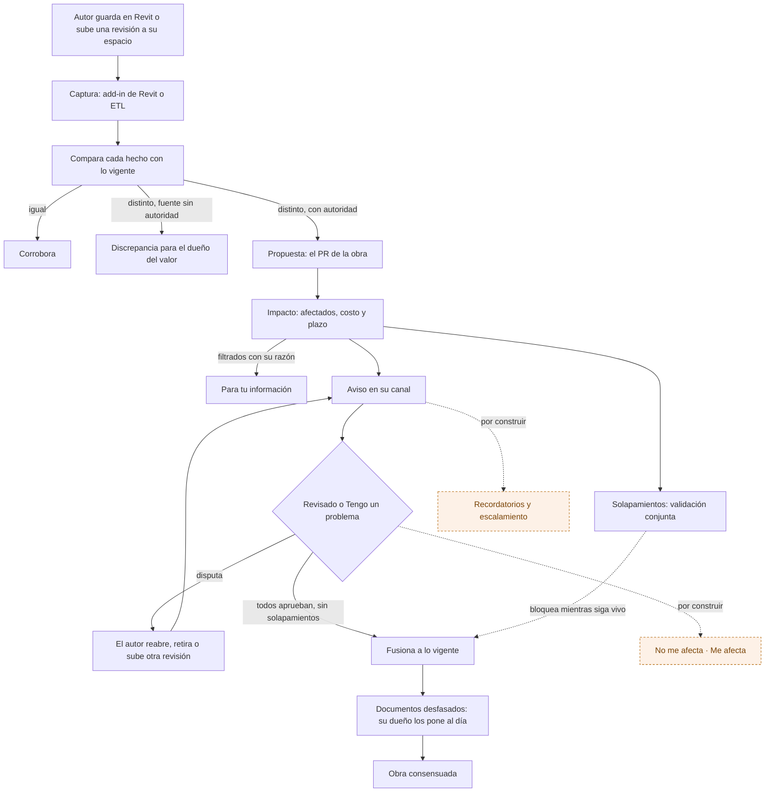
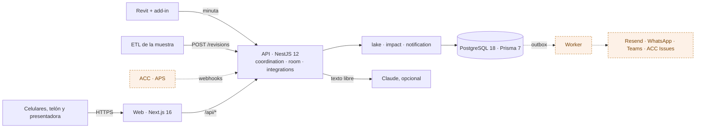

# Spec de Vigente

Esta carpeta junta en un solo lugar qué es Vigente, qué está construido, cómo se compara con el plan de 26 tareas y qué falta. Todo lo que falta se construye sobre el stack actual. Tiene cinco lecturas y dos diagramas:

| Archivo                                      | Para quién          | Qué trae                                                                                                                 |
| -------------------------------------------- | ------------------- | ------------------------------------------------------------------------------------------------------------------------ |
| [README.md](README.md)                       | El equipo           | La síntesis, el contraste con el plan, el backlog para Linear y las decisiones abiertas                                  |
| [ia.md](ia.md)                               | Un agente de código | Invariantes, mapa del código, la cadena de un cambio, cada tarea con su evidencia y recetas para construir               |
| [fuente-de-verdad.md](fuente-de-verdad.md)   | Todos               | El flujo de 4 pasos del pitch: el caso P-12 y la bandeja E-B-03, la verdad central, el choque, la propuesta y sus textos |
| [integraciones.md](integraciones.md)         | El equipo           | Los conectores de Google Sheets y ACC: conectar y escuchar, lo construido y lo que sigue                                  |
| [aec-data-model.md](aec-data-model.md)       | El equipo           | El spike de la tarea 7: si ACC da desde la nube el diff que arma el add-in, con sus límites y el ejemplo de la losa N3    |
| [flujo-usuario.drawio](flujo-usuario.drawio) | Todos               | El flujo de usuario de un cambio, desde que el autor guarda hasta «Obra consensuada»                                     |
| [arquitectura.drawio](arquitectura.drawio)   | Todos               | La arquitectura de software, con lo construido, lo simulado y lo que falta                                               |

Los `.drawio` se abren en [draw.io](https://app.diagrams.net) o con la extensión de draw.io para VS Code. En los dos, el verde lleno está construido, el verde punteado está simulado en la muestra y el naranjo punteado no existe en el código.

## En una página

- **Problema.** En una obra, muchos equipos toman decisiones interdependientes con herramientas distintas. Cuando alguien cambia algo, quienes dependen de eso no se enteran a tiempo, y la información desactualizada sigue avanzando: retrabajo, conflictos, atrasos y sobrecostos. La fuente es [negocio](../negocio.md#problema).
- **Propuesta de valor.** Convertimos el efecto de cada cambio en una respuesta coordinada antes de que afecte decisiones, costos o plazos ([negocio](../negocio.md#propuesta-de-valor)).
- **Solución.** Nos conectamos al software que el proyecto ya usa, capturamos cada cambio apenas ocurre, calculamos a quién afecta y con qué costo y plazo, y se lo llevamos a cada afectado en su canal. No reemplazamos herramientas ni centralizamos archivos.
- **La tesis del código** va más allá de avisar. Cada revisión de un documento es un PR contra **lo vigente**, la versión consensuada del proyecto: lo vigente cambia solo cuando confirman todos los afectados, y cada valor sabe de dónde salió ([solapamientos](../solapamientos.md), [multijugador](../multijugador.md)).
- **Lo que hay hoy** es una muestra para el pitch, no un MVP: un proyecto ficticio (Edificio Los Aromos), un elenco fijo, canales simulados dentro de la web y un ETL que hace de conectores. El único conector real de la ingesta es el add-in de Revit ([muestra](../muestra.md)). Aparte, hay una capa de cuentas opcional (Auth0, organizaciones y roles), la conexión de una organización con Autodesk y un canal que escucha planillas de Google Sheets sin entregarlas a la cadena: se activan con sus variables y no tocan la sala ni el flujo de 4 pasos, que no tienen usuarios.

## Dónde entra en una obra con BIM

| Etapa                         | Qué pasa en la obra                                                 | Qué hace Vigente hoy                                                                                                                                                                    | Qué falta                                                  |
| ----------------------------- | ------------------------------------------------------------------- | --------------------------------------------------------------------------------------------------------------------------------------------------------------------------------------- | ---------------------------------------------------------- |
| Idea y diseño conceptual      | El mandante fija el programa; casi no hay modelo                    | Nada: todavía no hay valores que coordinar                                                                                                                                              | Fuera de foco                                              |
| Modelado de arquitectura      | Revit o ArchiCAD: muros, puertas y losas como objetos               | El add-in de Revit manda la minuta de cada guardado, y cada valor que cambia abre una propuesta                                                                                         | ArchiCAD; leer el modelo desde ACC en vez del add-in local |
| Estructura e instalaciones    | Cada disciplina en su modelo, unidos en el modelo federado          | Los planos E-102 e IS-301 llegan como revisiones, y las dependencias dicen quién depende de qué (la calculista, del espesor de la losa)                                                 | Leer los modelos de estructura e instalaciones             |
| Coordinación y conflictos     | Navisworks o Solibri detectan choques y se emiten observaciones BCF | Solapamientos por área (nivel, celda de la grilla y sistema) con validación conjunta; en el caso del pitch, el choque entre cajas de P-12 y la bandeja E-B-03, con el arreglo propuesto | Choques sobre el modelo completo; importar y exportar BCF  |
| Cubicación y presupuesto (5D) | Cantidades del modelo por precios unitarios                         | Costo por reglas: la cantidad de cada partida por su precio                                                                                                                             | Leer el presupuesto de Presto o S10                        |
| Planificación (4D)            | El cronograma se vincula al modelo                                  | Plazo por reglas: duración por productividad y ruta crítica con holgura                                                                                                                 | Leer el cronograma de P6 o MS Project                      |
| Construcción                  | Cambios en terreno, por libro de obra y WhatsApp                    | Un WhatsApp o un folio no manda: abre una discrepancia para el dueño del valor, hasta que un plano la respalde                                                                          | Leer los canales reales                                    |
| Entrega y operación           | Modelo as built                                                     | La procedencia de cada valor: de dónde salió y quién lo confirmó                                                                                                                        | Fuera de foco                                              |

El valor está entre el modelado y la construcción, donde varias disciplinas cambian cosas en paralelo.

## Flujo de usuario

El detalle, con los actores en carriles, está en [flujo-usuario.drawio](flujo-usuario.drawio).

## Arquitectura

El detalle, con las rutas y lo que falta, está en [arquitectura.drawio](arquitectura.drawio). Los números del diagrama:

1. El add-in de Revit manda la minuta de cada guardado a `POST /api/integrations/revit/minutes`.
2. El ETL lee el lago ficticio y entrega cada revisión por `POST /api/revisions`, como cualquier conector.
3. `impact` lee el texto libre con Claude, o con respuestas fijas si no hay `ANTHROPIC_API_KEY`.
4. `coordination` encadena `lake`, `impact` y `notification` en una sola transacción de Postgres.
5. La web reenvía `/api/*` a la API y sondea `GET /api/events` para moverse en vivo.
6. Los celulares, el telón y la presentadora entran a la web por HTTPS.
7. Por construir: un worker lee una outbox en Postgres y entrega por los canales reales.

## La arquitectura propuesta frente al código

| Pieza propuesta                             | Lo que hay                                                                                      | Qué hacemos                                                                                                               |
| ------------------------------------------- | ----------------------------------------------------------------------------------------------- | ------------------------------------------------------------------------------------------------------------------------- |
| Turborepo                                   | Nx 24 con workspaces de pnpm 10                                                                 | Se queda Nx                                                                                                               |
| API en Fastify                              | NestJS 12, sobre Express                                                                        | Se queda Nest                                                                                                             |
| Drizzle                                     | Prisma 7, con doce migraciones                                                                  | Se queda Prisma                                                                                                           |
| Worker con pg-boss                          | La cadena corre sincrónica dentro de la API, en una transacción con advisory lock               | La cadena sigue sincrónica. Lo diferido (envío por canal, reintentos, recordatorios) va a una outbox en el mismo Postgres |
| Auth0 con organizaciones y login sin clave  | Auth0 para la identidad; organizaciones y roles en Postgres. La sala sigue con token de asiento | Opcional: sin `AUTH0_*`, las rutas con cuenta no funcionan y la web avisa que no hay cuentas                              |
| Webhooks de APS                             | El add-in de Revit y la ingesta genérica `POST /api/revisions`                                  | Un webhook es un conector más que termina en la misma ingesta                                                             |
| Resend, WhatsApp, Teams y ACC Issues        | Maquetas de correo, WhatsApp y Slack dentro de la web                                           | Un puerto `ChannelSender` en `notification`, con un adapter por proveedor                                                 |
| Sentry                                      | Nada                                                                                            | Se agrega a la API y la web: es una librería, no un cambio de stack                                                       |
| Desarrollo y staging, Postgres administrado | Docker compose en local; API y Postgres en Render y web en Vercel; un solo ambiente             | Falta staging                                                                                                             |
| Coordinadores por rol                       | Afectados (`Stakeholder`) con rol y canal, en `project_members`; la API los carga al arrancar   | Que un proyecto creado desde la web llegue a tener su elenco                                                              |

El flujo propuesto también difiere del construido en tres puntos:

- **El orden.** La propuesta pasa por detector de cambios, dependencias, conflictos, impacto y redactor. En el código, la revisión se compara con lo vigente y abre una propuesta; `analyzeChange` resuelve en un paso los afectados, el costo y el plazo; después se avisa, y los solapamientos se detectan al final. Un solapamiento no frena el aviso: frena la fusión.
- **El conflicto no es un aviso aparte.** Un solapamiento abre una validación conjunta para el autor de la revisión que llega y el dueño del otro documento. Además existen la discrepancia (fuente sin autoridad) y el desfase (documento que usa un valor viejo), que la propuesta no contempla.
- **El final.** La propuesta termina en «cambio coordinado». El código sigue: fusiona a lo vigente, marca los documentos desfasados con su dueño y, cuando no queda nada pendiente, muestra «Obra consensuada».

## Las 26 tareas frente al código

**Hecho** está construido como dice la tarea. **Distinto** está resuelto de otra forma. **Parcial** tiene una parte. **Falta** no existe. Quedan 6 hechas, 6 distintas, 6 parciales y 8 por hacer. La evidencia de cada una, con rutas, está en [ia.md](ia.md#las-26-tareas).

| #  | Tarea                                           | Estado   | Qué hay                                                                                                        | Qué falta                                                                    |
| -- | ----------------------------------------------- | -------- | -------------------------------------------------------------------------------------------------------------- | ---------------------------------------------------------------------------- |
| 1  | Monorepo y CI                                   | Distinto | Nx 24 + pnpm 10, ESLint 9, Prettier, Vitest y `pnpm check` en GitHub Actions                                   | Sentry                                                                       |
| 2  | Modelo de datos en Postgres                     | Parcial  | Prisma 7 con doce migraciones; el proyecto vive en la base, con organización y `project_id` en cada tabla      | Que la API sirva más de un proyecto: hoy carga uno al arrancar               |
| 3  | Autenticación con Auth0                         | Distinto | Auth0 para la identidad; organizaciones y roles `admin` y `member` en Postgres                                 | —                                                                            |
| 4  | Infraestructura y despliegue                    | Parcial  | Compose en local; Render (API y Postgres administrado) y Vercel; la clave la genera Render                     | Staging                                                                      |
| 5  | OAuth con APS                                   | Parcial  | OAuth de tres patas por organización, con los tokens cifrados en `aps_connections`                             | Que algo use esos tokens para leer ACC                                       |
| 6  | Receptor de webhooks de APS                     | Falta    | Ingesta genérica e idempotencia por `x-action-id`, en memoria                                                  | Firma, idempotencia persistente y encolado                                   |
| 7  | Spike de diff con AEC Data Model                | Distinto | El cambio por elemento ya existe: el add-in compara cada guardado y `lake` lo convierte en `Change`            | Spike hecho ([aec-data-model](aec-data-model.md)): sí, con límites; falta un hub de ACC |
| 8  | Parser de presupuesto Presto o S10              | Distinto | Parser determinista del presupuesto en CSV ficticio                                                            | Los formatos reales                                                          |
| 9  | Parser de cronograma P6 o MS Project            | Distinto | Parser determinista de la Carta Gantt en CSV ficticio                                                          | Los formatos reales                                                          |
| 10 | Worker y colas                                  | Falta    | Cadena sincrónica y transaccional                                                                              | Outbox, worker y reintentos                                                  |
| 11 | Detector de cambios                             | Hecho    | `lake`: compara con lo vigente según la autoridad de cada tipo de documento; un `Change` por elemento          | —                                                                            |
| 12 | Resolvedor de dependencias                      | Hecho    | `impact`: dependencias por atributo y filtrados con su razón; la capa de probabilidad existe sin conectar      | Que el grafo se pueda editar                                                 |
| 13 | Detector de conflictos                          | Hecho    | Solapamientos en anillos (mismo elemento, misma área, simultáneo) y validación conjunta                        | Choques geométricos                                                          |
| 14 | Calculador de costo y plazo                     | Hecho    | Cantidad por precio unitario, y ruta crítica con holgura                                                       | —                                                                            |
| 15 | Redactor de avisos                              | Parcial  | Un aviso por afectado con sus hallazgos (resumen, detalle y qué hacer); el canal solo cambia el look en la web | Plantillas de texto por canal                                                |
| 16 | Seguimiento                                     | Parcial  | El autor ve quién aprobó, disputó o falta; reabre o retira                                                     | «No me afecta», recordatorios y escalamiento                                 |
| 17 | Correo con Resend                               | Falta    | Correo simulado en la web                                                                                      | El envío real                                                                |
| 18 | WhatsApp con Meta Cloud API                     | Falta    | WhatsApp simulado en la web                                                                                    | Envío, plantillas aprobadas y recepción de respuestas                        |
| 19 | Teams con Graph API                             | Falta    | La muestra usa Slack simulado, no Teams                                                                        | Nice to have: el canal `teams` y su envío                                    |
| 20 | ACC Issues                                      | Falta    | —                                                                                                              | Todo                                                                         |
| 21 | Onboarding del administrador                    | Parcial  | Crear un proyecto desde la web, en una organización de quien lo crea                                           | Espacios, documentos, equipo y la conexión con ACC                           |
| 22 | Editor del mapa de dependencias                 | Falta    | El grafo está en la base (`project_dependencies`)                                                              | El editor                                                                    |
| 23 | Detalle y respuesta del aviso                   | Hecho    | `/cambios/[id]?para=` y la bandeja `/asiento/[castId]`, con «Revisado» o «Tengo un problema» y nota            | —                                                                            |
| 24 | Vista de estado del autor y el jefe de proyecto | Hecho    | `/sala`, `/presentador` y «Tus propuestas»                                                                     | —                                                                            |
| 25 | Proyecto de prueba y punta a punta              | Distinto | Los Aromos con el guion del ETL: `pnpm etl auto` llega a «Obra consensuada»; test de oro de los hechos         | Un proyecto en ACC, tests contra Postgres y probar el add-in dentro de Revit |
| 26 | Métricas del piloto                             | Falta    | Los avisos guardan canal, envío y respuesta: alcanza para medir                                                | La vista; la tasa de «no me afecta» necesita esa respuesta                   |

### Lo que el código tiene y el plan no

El plan describe un notificador. El código, además, ya construyó lo que la [auditoría](../auditoria.md#veredicto) marcó como lo valioso:

- **Lo vigente consensuado.** Cada revisión con autoridad abre una propuesta, y lo vigente cambia solo cuando todos sus revisores aprueban.
- **Autoridad por tipo de documento.** Un plano manda sobre el diseño, una cotización sobre el precio y una Carta Gantt sobre las fechas. Un WhatsApp o un folio no mandan sobre nada: abren una discrepancia.
- **Desfase y procedencia.** Cada documento que usa un valor viejo queda marcado con su dueño, y cada valor responde de dónde salió.
- **Lectura de texto libre.** Claude lee WhatsApp, folios y actas, con su confianza; sin clave, la lectura es determinista.
- **Capa de probabilidad (Mano alzada).** Estima quién más puede estar afectado. Existe en `impact` y falta conectarla a la API.
- **La sala multijugador.** El público toma asientos desde el celular, y el ETL juega los asientos vacíos.
- **El add-in de Revit**, que es el único conector real.

## Backlog para Linear

Todo vive en un solo proyecto de Linear, «Vigente», y cada issue lleva una etiqueta: **Pitch** (lo que falta para la muestra), **Producto** (el plan, después del pitch) o **Nice to have**. Las dependencias entre tareas están cargadas como bloqueos. Las tareas del plan que ya están construidas están en Done, asignadas a quien las hizo.

### Muestra, antes del pitch

Salen de los [segmentos de la muestra](../muestra.md#segmentos) y del [plan de la auditoría](../auditoria.md#plan).

| Tarea                         | Qué es                                                                                                          | Listo cuando                                                                                          |
| ----------------------------- | --------------------------------------------------------------------------------------------------------------- | ----------------------------------------------------------------------------------------------------- |
| Probar el add-in en Revit     | Segmento 6: compilarlo, instalarlo y correr la losa, el shaft y las ventanas en un modelo mínimo                | Guardar la losa N3 en 20 cm abre la propuesta con +$3.636.500 y +1 día, y la sala la muestra          |
| Conectar `SuggestAffected`    | Segmento 7: la capa de probabilidad propone afectados que las reglas no vieron                                  | La propuesta trae a quién preguntar (`ask`) y a quién mirar (`watch`), con su probabilidad, sin tocar las cifras ni los revisores |
| Estabilizar la sala           | `error.tsx` y `loading.tsx`, tests de la API contra Postgres y un script de 30 clientes                         | 30 clientes sondean 5 minutos y un voto se ve en menos de 2 s                                         |
| Presencia en el telón         | Avatares de humano y bot y un contador de personas en `/sala`                                                   | Con 0, 2 o 30 personas la demo sigue viva                                                             |
| Silencio visible              | Plazo de demo por asiento y «sin respuesta» con nombre y hora; adelanta el seguimiento (tarea 16)              | Con un asiento que no responde, el telón dice «sin respuesta» y no fusiona                            |
| Mano alzada                   | Declarar «me afecta», validarlo y reabrir con un revisor nuevo. Solo si el equipo la adopta                    | Camila declara, el costo se recalcula con su rótulo y los votos se reinician                          |
| Entrega y ensayo              | Alinear `README.md` y `project-description.md` (tienen sus propias reglas) y ensayar con cronómetro             | Tres ensayos de 3 minutos sin intervenir fuera del botón                                              |

### Producto, después del pitch

Las tareas del plan, reescritas para el stack actual y en el orden en que se destraban. Entre paréntesis, la tarea original.

| Tarea                                | Qué es                                                                                                                                                                                                                                                        | Depende de                  |
| ------------------------------------ | ------------------------------------------------------------------------------------------------------------------------------------------------------------------------------------------------------------------------------------------------------------- | --------------------------- |
| El proyecto en la base (2)           | Construido: el proyecto, el elenco, el grafo, los documentos y las áreas están en Postgres, con `project_id` en cada tabla. Queda servir más de un proyecto (la API carga uno al arrancar) y cargar uno creado desde la web, que no trae grilla ni documentos | —                           |
| Cuentas y organizaciones (3)         | Construido: Auth0, organizaciones, miembros, invitaciones y roles `admin` y `member`, opcional con las variables `AUTH0_*`                                                                                                                                    | El proyecto en la base      |
| Observabilidad (1)                   | Sentry en la API y la web                                                                                                                                                                                                                                     | —                           |
| Staging (4)                          | Un segundo servicio y una segunda base en Render, y la web de preview en Vercel                                                                                                                                                                               | —                           |
| Outbox y worker (10)                 | Una tabla outbox en Prisma, escrita en la misma transacción de la cadena, y un worker de Nest que la procesa con reintentos                                                                                                                                   | —                           |
| Plantillas por canal (15)            | El texto de cada aviso según su canal y el rol del afectado, en el dominio de `notification`                                                                                                                                                                  | —                           |
| Correo con Resend (17)               | Primer adapter del puerto `ChannelSender`                                                                                                                                                                                                                     | Outbox, plantillas          |
| WhatsApp (18)                        | Meta Cloud API con plantillas aprobadas, y un webhook que convierte la respuesta en voto                                                                                                                                                                      | Outbox, plantillas          |
| Slack y Teams (19), nice to have     | Un adapter para cada uno (la API de Slack y Graph API), y `teams` en los canales. En la muestra, Slack sigue simulado                                                                                                                                         | Outbox, plantillas          |
| ACC Issues (20)                      | El aviso como issue en ACC                                                                                                                                                                                                                                    | Conexión con APS, outbox    |
| Seguimiento (16)                     | «No me afecta» como respuesta, recordatorios y escalamiento                                                                                                                                                                                                   | Outbox                      |
| Conexión con APS (5)                 | Construido: OAuth de tres patas por organización y tokens cifrados en Postgres. Queda usarlos para leer ACC                                                                                                                                                   | Cuentas                     |
| Webhooks de APS (6)                  | Una ruta de Nest con firma validada e idempotencia persistente, que encola y termina en la ingesta                                                                                                                                                            | Conexión con APS, outbox    |
| Conector de AEC Data Model (7)       | Comprobar el [spike](aec-data-model.md) en un hub de ACC y, si se confirma, armar la minuta desde la nube                                                                                                                                                     | Conexión con APS            |
| Presupuesto de Presto o S10 (8)      | Parser de la exportación real hacia fragmentos con hechos, con test de oro                                                                                                                                                                                    | —                           |
| Cronograma de P6 o MS Project (9)    | Parser de la exportación real hacia fragmentos con hechos, con test de oro                                                                                                                                                                                    | —                           |
| Onboarding del administrador (21)    | Crear el proyecto ya existe. Queda sumar espacios y documentos, conectar ACC y elegir las carpetas de presupuesto y cronograma                                                                                                                                | El proyecto en la base, APS |
| Editor del mapa de dependencias (22) | Editar el grafo, que ya está en la base, e importar uno inicial                                                                                                                                                                                               | El proyecto en la base      |
| Piloto en ACC y punta a punta (25)   | Un proyecto de prueba en ACC y el camino feliz automatizado contra Postgres                                                                                                                                                                                   | APS, webhooks               |
| Métricas del piloto (26)             | Tiempo de respuesta, respuesta por canal y tasa de «no me afecta», derivados de los avisos                                                                                                                                                                    | Seguimiento                 |

## Decisiones abiertas

1. **¿Outbox propia o pg-boss?** Las dos corren sobre el mismo Postgres. La outbox no suma dependencias; pg-boss trae reintentos y programación hechos.
2. **¿Se adopta Mano alzada?** Cambia el pitch y suma «me afecta», que es la otra cara de «no me afecta» (ver [auditoría](../auditoria.md#decisiones-para-el-equipo)).
