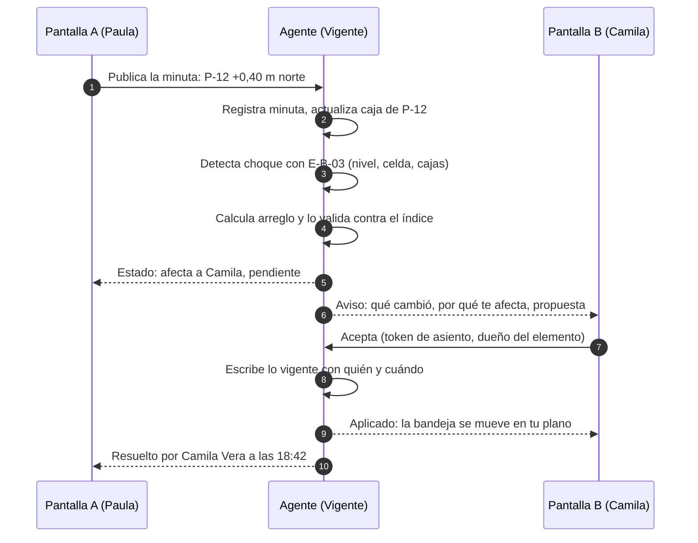

# Diseño del servicio: el flujo de 4 pasos sobre la verdad central

Estado: el flujo de 4 pasos (`/caso`, `/api/flow`) está guardado en el lago de Postgres y se proyecta desde ahí; el resto es diseño. Las cotas del caso son provisorias hasta que alguien que conozca obra las confirme. Todo lo marcado «a verificar» depende de APIs externas (Autodesk, Revit, Excel) que aún no se probaron.

## 1. En cinco líneas

1. Vigente es el administrador de la verdad central de un proyecto de construcción. Las fuentes (Autodesk y Excel) le mandan minutas, que son registros estructurados de cambio, y los archivos se abren solo cuando hace falta.
2. El primer corte vertical es un solo caso ensayado con dos personas reales: Paula Rojas (estructura) mueve el pilar P-12 40 cm al norte, el agente detecta que la bandeja E-B-03 del eje B choca, propone correrla 40 cm, Camila Vera (instalaciones eléctricas) acepta y su plano se corrige a la vista. Paula ve «Resuelto por Camila Vera a las 18:42».
3. El agente propone y la persona decide. Los números (vector, penetración, holgura) salen siempre de código determinista y se validan contra el índice de elementos; el modelo de lenguaje solo redacta el porqué.
4. Hasta que ese flujo corra de punta a punta no entra nada más: ni votos, ni unanimidad, ni bots como respondedores, ni Excel real, ni otros tipos de colisión. Este documento describe el servicio completo como destino; el sábado se construye solo la porción que el flujo necesita.
5. Lo que se ve en el escenario es colaboración: el trabajo de una persona cambia en la pantalla de la otra porque esa otra aceptó.

## 2. El flujo de 4 pasos

### El caso (cotas provisorias)

Edificio Los Aromos, nivel 3, eje B-6. Ejes numéricos del 1 al 6, de oeste a este cada 6 m (x de 0 a 30 m); letras A, B y C de sur a norte cada 6 m (y = 0, 6 y 12 m). Cotas en metros.

| Elemento                                                      | Dueña       | Caja antes (min / max)                  | Caja después               |
| ------------------------------------------------------------- | ----------- | --------------------------------------- | -------------------------- |
| `P-12`, pilar de 40 x 60 cm, H30, en B-6 (centro 30,00; 6,00) | Paula Rojas | x 29,80–30,20, y 5,70–6,30, z 0–2,55    | y 6,10–6,70                |
| `E-B-03`, bandeja escalerilla de 300 x 100 mm, tramo movible  | Camila Vera | x 26,00–32,00, y 6,45–6,75, z 2,25–2,35 | y 6,85–7,15 (tras aceptar) |

La bandeja sale del shaft S1 en B-2 (x = 6) hacia el este y llega al tablero TDA-N3 (x = 32); corre 0,60 m al norte del eje B. Solo el tramo de x 26,00 a 32,00 puede moverse. El índice incluye además el colector B2 (sanitarias, x 5,00–7,00, y 6,40–6,60, z 2,20–2,30, de Javier Muñoz) y el cielo falso del nivel 3 (arquitectura, plano z = 2,40, de Fernanda Lagos). Las losas son soporte y no chocan.

Reglas de holgura, criterio de proyecto (las normas que las respaldan están «a verificar»): estructura a eléctricas, 0,15 m; eléctricas a arquitectura (cielo falso), 0,05 m; estructura a arquitectura, exenta.

Aritmética del caso, para que cuadre en la demo:

- Antes del movimiento, la cara norte de P-12 está en y 6,30 y el borde sur de la bandeja en 6,45: holgura de 0,15 m, que cumple justo.
- Tras mover P-12 40 cm al norte, su cara norte llega a y 6,70: el pilar atraviesa la bandeja 0,25 m (de 6,45 a 6,70) en x 29,80–30,20, z 2,25–2,35. Es un choque duro.
- Para recuperar la holgura de 0,15 m el tramo se traslada 0,25 + 0,15 = 0,40 m al norte, redondeado hacia arriba a múltiplos de 0,05, y queda en y 6,85–7,15. Se valida sin choque con P-12, con el cielo falso (tope 2,35, igual a 2,40 menos 0,05) ni con el colector B2, a más de 24 m. Si un candidato falla se prueba el siguiente múltiplo hasta 1,00 m; si ninguno sirve, el choque queda «sin arreglo automático».
- Costo (hoja «Presupuesto», cifras ilustrativas, partida 12): retiro y reinstalación de escalerilla 300 mm, 6 m a $9.500; dos curvas de 45°, $29.600; cinco consolas, $56.000; 1 m de escalerilla adicional, $18.900. Total $161.500 + IVA. Plazo 0,5 día, fuera de la ruta crítica.

### Los cuatro pasos y el cierre

1. **Mueve.** Paula (estructura) mueve P-12 40 cm al norte y publica el cambio.
2. **Detecta.** El agente calcula a quién afecta: la bandeja E-B-03 de Camila Vera.
3. **Avisa con el porqué y una propuesta.** Camila recibe en su pantalla qué cambió, por qué le afecta y la propuesta concreta: correr 40 cm al norte el tramo de 6 m de la bandeja.
4. **Acepta.** Camila acepta; el agente aplica el cambio en su plano. Paula ve «Resuelto por Camila Vera a las 18:42».



### Qué muestra cada pantalla

**Pantalla A, Paula (`/caso/paula-rojas`).** Plano en SVG con P-12 y su posición anterior. El botón «Mover P-12 40 cm al norte» emite la minuta (con Revit, la emitiría el add-in). Debajo, la línea de tiempo: «Cambio enviado: P-12 se movió 40 cm al norte (Nivel 3, eje B-6). Vigente encontró 1 equipo afectado: Instalaciones eléctricas (Camila Vera).», «Esperando a Camila…», «Camila está revisando tu cambio» (con su presencia) y «Resuelto por Camila Vera a las HH:MM».

**Pantalla B, Camila (`/caso/camila-vera`).** El plano marca el choque achurado en rojo y la propuesta como fantasma verde. La tarjeta, en este orden: título («El pilar P-12 se corrió 40 cm al norte y pisa tu bandeja del eje B»), el porqué (quién, cuándo, y que el pilar atraviesa la bandeja 25 cm), la propuesta («correr 40 cm al norte el tramo de 6 m de la bandeja E-B-03, entre x = 26,0 y 32,0 m, con dos quiebres de 45°; queda a 15 cm del pilar»), los chequeos (P-12 a 15 cm, colector B2, cielo falso), el costo y el plazo, y los botones «Aceptar propuesta» y «Tengo un problema» (con motivo). Pie: «Vigente propone; tú decides. No se cambia nada hasta que aceptes.» Al aceptar, el tramo se desliza a su nueva posición y la tarjeta queda con «Aplicado en tu plano a las HH:MM».

**Presentador (`/caso`).** Pide la clave de presentador. Las dos pantallas lado a lado como componentes (no iframes, que tomarían los asientos reales), el hilo de eventos `flow.*` y el botón «Reiniciar caso».

**«Resuelto» por quién y cuándo.** Sale de la procedencia de lo vigente: `decidedBy` y `decidedAt` de la propuesta aceptada, y el re-chequeo del índice sin el choque. La hora se escribe en el servidor, en `America/Santiago`. No es un texto armado a mano.

## 3. El agente: detección y propuesta de arreglo

El agente es un contexto hexagonal nuevo, `context/clash`, con dominio puro y testeable sin base de datos. La API orquesta: un contexto nunca importa a otro, así que el módulo de la API llama a `clash` cuando el lago registra un cambio que altera una caja.

### Detección en dos fases

- **Fase ancha.** Se toman las celdas de la caja nueva (nivel y celda de la grilla, que ya existen en `areas.ts`) y se piden los candidatos de otras disciplinas. Con ~30 cajas sembradas el sábado basta una lista plana; la grilla se agrega sin cambiar la interfaz.
- **Fase estrecha.** Intersección de cajas alineadas a los ejes, inflada por la holgura del par de sistemas. Resultado: `Clash { a, b, kind, penetration, minTranslation }`.
- **Reglas anti-ruido** (el sábado solo las dos primeras): ignorar si uno aloja al otro (host) y deduplicar por clave de choque (una propuesta abierta por par). Después: tolerancia bajo 1 cm, choque aprobado por clave estable `hash(ids ordenados, tipo)` que no vuelve a sonar mientras las cajas no cambien, cambios que no tocan la caja, y mismo dueño en ambos elementos.

### Propuesta de arreglo

El elemento que se mueve es el movible del afectado, nunca el que causó el cambio. Candidatos en orden, cada uno validado moviendo la caja y re-corriendo la detección contra todo el índice (con el pilar ya movido):

Construido hoy: el desplazamiento mínimo en la dirección de la causa (+y) que restaura la holgura, redondeado hacia arriba a múltiplos de 0,05 m, probando cada múltiplo hasta 1,00 m. Diseñado para después: el mismo vector que la causa, el mínimo en el eje opuesto y subir o bajar en z cuando el tipo lo permita.

Se acepta el primero sin choques nuevos y dentro del recorrido máximo del tipo. Si ninguno valida, la propuesta queda `sin_arreglo`: el aviso sale igual, sin botón Aceptar, y se escala a una conversación entre las dos personas.

### El modelo de lenguaje, acotado

Recibe un JSON cerrado con los hechos ya calculados y devuelve solo `why` y `proposal`. Si el texto contiene un número que no está en el JSON, se descarta y se usa la plantilla fija. Sin modelo disponible, plantilla. El flujo nunca depende de él: el sábado va con plantilla; el domingo, con verificación de números, si sobra tiempo.

### Payload de la propuesta

Es el `proposal` del `FlowState` que entrega `GET /api/flow`. La API es `/api/flow` (`GET /flow`, `POST /flow/minutes`, `POST /flow/proposals/:id/accept`, `POST /flow/proposals/:id/reject`, `POST /flow/presence`, `POST /flow/reset`); el detalle está en [apps/api/README.md](../../apps/api/README.md).

```json
{
  "id": "…",
  "clashId": "…",
  "elementId": "E-B-03",
  "ownerId": "camila-vera",
  "delta": { "dx": 0, "dy": 0.4, "dz": 0 },
  "segment": { "fromX": 26, "toX": 32 },
  "clearanceAfter": 0.15,
  "checks": [
    { "label": "P-12 (15 cm)", "ok": true },
    { "label": "Colector B2", "ok": true },
    { "label": "Cielo falso", "ok": true }
  ],
  "cost": { "lines": [{ "code": "12.03.02", "detail": "Retiro y reinstalación de escalerilla 300 mm", "quantity": 6, "unit": "m", "price": 9500, "total": 57000 }], "total": 161500, "currency": "CLP", "vat": false },
  "schedule": { "days": 0.5, "critical": false },
  "texts": { "title": "…", "why": "…", "proposal": "…", "cost": "…", "footer": "…" },
  "status": "propuesta",
  "decidedBy": null,
  "decidedByName": null,
  "decidedAt": null,
  "rejectReason": null,
  "appliedText": null,
  "resolvedText": null
}
```

El texto sale de plantilla con los números del cálculo. El modelo de lenguaje queda como diseño.

### Estados

Una sola máquina, con transiciones puras en el dominio guardadas como eventos que solo se agregan:

`propuesta → aceptada → aplicada → resuelta` (el choque pasa de `detectada` a `resuelta`; la API completa la cadena de la propuesta en una sola llamada de aceptar)

Construido: `propuesta → rechazada` (con motivo, visible para Paula). Diseñado para después: `propuesta → obsoleta` (el índice cambió y el arreglo ya no valida; se recalcula y vuelve a `propuesta` con otra `revision`), `aplicada → propuesta` (si el re-chequeo detecta un choque; se prueba en test).

### Tests de dominio

`context/lake/tests/domain/spatial.spec.ts`: P-12 +0,40 m en y da exactamente un choque (con la bandeja, penetración 0,25 en y); el arreglo es +0,40 m, deja el tramo en y 6,85–7,15 y pasa los tres chequeos; un ducto que bloquea sube el arreglo a 0,50 m; un muro que bloquea da `null` (sin arreglo automático); las losas no chocan; la holgura bandeja–cielo falso queda justo en 0,05. `apps/api/tests/modules/flow/flow-engine.spec.ts` cubre la máquina sin base de datos: textos exactos, 403 y 404 y 409, idempotencia por `minuteId` y al aceptar, rechazo y presencia.

## 4. La verdad central y el lago de minutas

Este es el servicio completo. El sábado se construye solo lo marcado en la sección 8.

### Capas, de lo crudo a lo vigente

1. **Libro de minutas.** Una fila por minuta recibida, sin editar: `source` (`autodesk` o `excel`), `sourceRef`, `sourceVersion` (entero creciente de la fuente), `idempotencyKey` = hash(integración, `sourceRef`, `sourceVersion`), `payload` crudo y `status`. Un reenvío con la misma clave devuelve el recibo original. Una minuta con versión menor a la ya aplicada se guarda pero no mueve lo vigente. Reprocesar es leer el libro de nuevo.
2. **Registro de elementos.** Cada elemento tiene un `elementId` propio y estable (por ejemplo `P-12`, `E-B-03`), disciplina, dueño (asiento), nivel, celda, tipo, caja y alias (`GlobalId` de IFC, `UniqueId` de Revit, clave de fila de Excel). Si Revit regenera un id, se re-vincula por el parámetro `Clave obra`, que el add-in ya usa, y se suma el alias.
3. **Vínculos.** `(source, sourceRef, locator) → elementId`. Lo que no tiene vínculo va a una bandeja de sin vincular, con la minuta intacta en el libro; se vincula después y se reprocesa. Nada se pierde.
4. **Lo vigente.** Es lo que ya existe en el lago: hechos por sujeto y atributo, con historia y procedencia. El sujeto pasa a ser el `elementId` cuando hay vínculo. Cada valor vigente guarda quién lo aceptó, cuándo, de qué minuta o propuesta salió y una `truthVersion` del proyecto. Volver a cualquier punto es recalcular hasta la versión N.

### Lo que está construido

El caso de 4 pasos ya vive en el lago, con las capas 4 y parte de la 1 de arriba:

- **Lo vigente.** Cada elemento del caso es un sujeto `caso.<id>` con el atributo `ubicacion_m`, cuyo valor es la caja en texto canónico (`encodeBox`/`decodeBox` del lago). Se siembra a demanda con una revisión `base` por documento (`LosAromos_EST`, `LosAromos_ELEC`, `LosAromos_SAN`, `LosAromos_ARQ`).
- **La minuta de Paula** es una revisión inmutable de `LosAromos_EST` con el `minuteId` como etiqueta única (la clave de idempotencia: el mismo `minuteId` devuelve el mismo estado, también tras reiniciar la API), un fragmento por cambio y su hecho.
- **El PR del caso** es una propuesta del lago con dos hunks (P-12, el cambio, y E-B-03, el arreglo que Vigente propuso, en una revisión de `LosAromos_ELEC` con autor `vigente`) y como revisora la dueña del elemento afectado. No es vigente hasta que acepta.
- **Aceptar** registra la revisión de Camila y fusiona la propuesta: lo vigente cambia y su historia guarda el valor anterior; la procedencia dice qué minuta de Paula y a qué hora, que Vigente propuso el arreglo y que Camila lo aprobó a las HH:MM. **Rechazar** registra la disputa con su motivo y deja lo vigente igual.
- **`GET /api/flow`** es una proyección del lago (más la presencia, en memoria); un reinicio de la API rehidrata el estado exacto, a mitad del flujo o ya resuelto. `GET /api/flow/history` entrega la historia de P-12 y E-B-03 para el panel «Historia» de `/caso`.
- **Reinicio.** El del caso borra solo sus registros y lo resiembra; el de la sala vacía el lago y el caso se resiembra en el siguiente pedido. Diez ensayos no acumulan historia.

Todavía no existe: el libro de minutas con `sourceVersion`, el registro de elementos con alias, los vínculos y la bandeja de sin vincular, la minuta de Excel, las URLs prefirmadas ni la autoridad por fuente.

### Regla de aceptación

**El afectado acepta y se aplica.** Una persona por elemento afectado, sin votos: solo el dueño del elemento afectado (asiento humano con token) puede aceptar o rechazar. La aceptación es una transacción: marca la propuesta, escribe los hechos nuevos en lo vigente con procedencia `{ por, cuándo, propuesta }`, sube la versión y emite el evento de aplicado. Es idempotente por id de propuesta.

### Autoridad entre fuentes

Cada atributo tiene una sola fuente autoritativa. Propuesta: geometría y posición mandan desde Autodesk; cantidades, precios y partidas, desde Excel. La otra fuente solo puede levantar una discrepancia (consistencia entre Excel y modelo), nunca sobrescribir. El orden es por versión de la fuente dentro de una misma fuente; entre fuentes no se ordena por reloj.

### Contratos de minuta

Autodesk, extensión de la minuta actual de Revit. Hoy el add-in manda valores numéricos sueltos por atributo; la extensión suma ubicación como vector, caja y versión de la fuente. El esquema actual debe seguir aceptándose sin cambios (compatibilidad hacia atrás); los campos nuevos son opcionales. Se verifica contra `revitMinuteBody` antes de tocarlo.

```json
{
  "source": "autodesk",
  "sourceRef": { "model": "LosAromos_EST.rvt" },
  "sourceVersion": 7,
  "savedAt": "2026-11-21T18:40:00Z",
  "changes": [
    {
      "locator": { "uniqueId": "a verificar", "globalId": "a verificar", "claveObra": "P-12" },
      "attribute": "location",
      "before": { "x": 8.0, "y": 3.2, "z": 0 },
      "after": { "x": 8.0, "y": 3.6, "z": 0 },
      "box": { "min": [7.8, 3.4, 0], "max": [8.2, 3.8, 3.0] },
      "unit": "m"
    }
  ]
}
```

Excel: las tablas son tablas con nombre, no rangos A1, y la fila se identifica por una columna clave, no por su posición. Así un valor se identifica por tabla, fila y columna y sobrevive a que alguien inserte filas.

```json
{
  "source": "excel",
  "sourceRef": { "workbook": "presupuesto.xlsx" },
  "sourceVersion": 12,
  "changes": [
    {
      "table": "Electrico",
      "rowKey": { "ItemId": "BAN-100-B" },
      "column": "Cantidad",
      "before": 12,
      "after": 12.4,
      "unit": "m"
    }
  ]
}
```

Cómo emite Excel la minuta (Office Scripts, Office.js o un observador del archivo) está a verificar. El sábado, la línea de costo de la propuesta («+0,4 m de bandeja») puede venir precalculada en la semilla; no hay minuta real de Excel.

### Abrir el archivo solo cuando hace falta (URLs prefirmadas)

- **Quién las genera:** solo la API, con la credencial de la integración (el token de dos patas de APS ya existe en el módulo `aps`). Nunca el cliente, nunca el visor.
- **Desde qué referencia:** el almacenamiento y la versión guardados en el libro (`sourceRef` y versión), jamás una URL que mande el cliente.
- **Cuánto duran:** minutos, con tope fijado por configuración (vencimiento máximo de las URLs de APS y del almacenamiento a verificar).
- **Auditoría:** cada emisión deja `actor`, `minuteId` o `elementId` más versión, `issuedAt`, `expiresAt` y propósito.
- El sábado se usa el token de visor que la API ya emite, y se registra el acceso.

### Operación

Credencial por integración con alcance por proyecto (hoy el add-in usa la llave del presentador; pasa a credencial propia); idempotencia por clave; reintentos del add-in en orden (la cola ya existe); reproceso desde el libro; una línea de log por paso con ids de minuta, cambio y propuesta; escala y retención se definen después. Nada de esto entra el sábado.

### Los cinco tipos de colisión, a futuro

Entre datos, sobre el mismo elemento, geométricas entre disciplinas (esta sección 3 es su primera versión), entre cambios simultáneos y de consistencia entre Excel y el modelo. Todas comparten ciclo de vida (la máquina de la sección 3), deduplicación y choques aprobados. Solo la geométrica básica se construye ahora.

## 5. Cómo el cambio llega al plano del afectado

**Camino elegido para el sábado: lo vigente, leído por el visor de la web.** Hoy, al aceptar, el servidor fusiona el arreglo en lo vigente del lago (la caja de E-B-03) y emite `flow.fix.applied`, y el plano SVG de `/caso` desliza el tramo. Diseñado para después: escribir en lo vigente, y que el visor de Eléctrico cargue el modelo APS (el que ya existe en `/modelos`, con disciplinas alineadas) y desplaza la bandeja a su posición vigente con una transición breve. La pantalla dice «aplicado en el modelo vigente»: no escribimos en el archivo de Revit y lo decimos en voz alta en el pitch.

**Respaldo.** Si mover un fragmento en el visor APS no se confirma (el modelo traducido puede no traer la bandeja como elemento propio; cambiar el color por `dbId` ya se hace hoy, mover un fragmento está a verificar), un plano 2D propio en SVG con las cajas muestra el mismo movimiento. Se decide con una prueba de 30 minutos sobre el modelo real antes de las 22:00.

**Caminos reales, posteriores y a verificar.**

- El add-in de Eléctrico consulta órdenes pendientes y mueve el elemento con la API de Revit dentro de una transacción disparada desde un evento externo.
- Automatización de diseño de APS abre el archivo en la nube, aplica el movimiento y guarda una versión nueva; por tiempos no sirve para escenario en vivo.

**Entrada del paso 1.** Dos caminos con el mismo contrato de minuta. B (por defecto): la sala, con un botón (después, arrastrar el pilar) que publica la minuta con `source: "sala"`; corre en cualquier navegador y se ensaya cien veces. A: el add-in de Revit con ubicación y caja, solo si el ensayo sale limpio tres veces seguidas y hay un equipo Windows con Revit y licencia; si no, un video corto. El add-in hoy lee espesor, ancho, alto, posición y cantidad; la ubicación como vector es trabajo nuevo.

## 6. Colaboración visible

- Dos asientos humanos con token (`/caso/paula-rojas` y `/caso/camila-vera`, sobre los asientos que ya existen), con los roles de estructura y de instalaciones eléctricas. Quien responde en el pitch es una persona.
- **Sin bots en el camino del pitch.** Hoy un asiento vacío se repone con un bot. Se agrega una bandera de sala «sin bots» que impide la reposición, no solo desactiva el relleno en el reinicio. Si Camila no está, la propuesta queda pendiente y Paula ve «Esperando a Camila…». El conductor de `apps/etl` queda para ensayo y carga, nunca como afectado.
- Presencia: el latido que ya existe, con el nombre de la otra persona y «viendo el mismo nivel». Los eventos por consulta periódica cada 0,5 a 1 s bastan. Cursores compartidos con Yjs quedan para después.
- Lo que hace sentir la colaboración no es el cursor sino que el plano de Camila cambia, y Paula lo ve, porque Camila decidió.

Eventos del flujo en `/events`: `change.recorded`, `clash.detected`, `fix.proposed`, `fix.accepted` o `fix.rejected`, `fix.applied`, `fix.resolved`.

## 7. Qué se mantiene, cambia o posterga

**Se mantiene.** `context/lake` (revisiones, lo vigente con historia y procedencia, discrepancias, desactualización), `context/notification`, el módulo de sala (asientos con token, eventos, presencia), el módulo `aps` y `/modelos`, la minuta del add-in de Revit con su cola, `areas.ts` como base de celdas.

**Cambia.**

- Nuevo `context/clash` (dominio puro; casos de uso, puertos y adapters después). El contexto `impact` sigue estimando costo y plazo.
- El consenso gana un parámetro `rule: "owner" | "unanimous"`. Por defecto sigue `unanimous`, así los tests y docs actuales no se rompen; el flujo usa `owner`. Cambiar el valor por defecto queda para cuando el flujo esté firme.
- La minuta suma ubicación, caja y versión de la fuente, sin romper el esquema actual.
- La sala suma la bandera «sin bots»; `/presentador` muestra los eventos nuevos y reinicia el caso.
- Docs: `docs/multijugador.md` y el contrato del add-in se actualizan en el mismo cambio que el código.

**Se posterga.** Votos, rondas y unanimidad entre varios afectados; solapamientos con validación conjunta como camino principal; Excel como fuente real y sus colisiones de consistencia; los otros cuatro tipos de colisión; libro de minutas completo, vínculos, bandeja de sin vincular, autoridad por atributo, credencial por integración, reproceso y retención; URLs prefirmadas con auditoría completa; Yjs; diferencias por GlobalId sobre IFC y visor IFC en el navegador; escritura real a Revit; tablas propias para elementos y para el libro de minutas (el flujo ya persiste en las tablas del lago).

## 8. Plan

**Dueños.** Una persona por paso, más una que integra. Cada dos horas se muestra corriendo, no contado.

| Rol                        | Dueño de                                                                                    | Entrega a las 20:00                                   |
| -------------------------- | ------------------------------------------------------------------------------------------- | ----------------------------------------------------- |
| Paso 1, origen             | Botón «Mover 40 cm» y `POST` de cambio de la sala, minuta con ubicación y caja              | Publicar crea la revisión y emite `change.recorded`   |
| Paso 2, detección          | `context/clash`: elementos sembrados, detección, test del caso                              | P-12 +0,40 m devuelve un choque con E-B-03 y su dueño |
| Pasos 3 y 4, pantalla B    | Propuesta con plantilla, tarjeta, endpoint de aceptar                                       | Tarjeta visible en B con porqué y botón Aceptar       |
| Cierre, aplicar y resolver | Escritura a lo vigente con procedencia, evento de aplicado, visor y tarjeta «resuelto» en A | (22:00) Aceptar cambia lo vigente y A ve «resuelto»   |
| Integra                    | Sala sin bots, `/presentador`, guion, ensayos, caso con quien conoce obra                   | El flujo corre una vez de punta a punta               |

**Corte a las 20:00.** Criterio único: publicar el cambio de P-12 en la pantalla A hace aparecer la tarjeta de propuesta en la pantalla B, con dos personas, sin bots. Si no corre, se recorta en este orden: fuera el modelo de lenguaje; fuera el camino de Revit; fuera Rechazar con motivo (solo Aceptar); fuera la animación del visor; fuera el visor APS a favor del plano 2D en SVG. No se agrega nada nuevo hasta que corra una vez completo.

**Hitos.** 20:00: paso 1 gatilla paso 3. 22:00: Aceptar aplica y A ve «resuelto». 00:00: visor con movimiento y vista previa de la propuesta. Domingo temprano: rechazo con motivo, validación del arreglo con caso «sin arreglo», porqué con modelo de lenguaje y verificación de números, guion con nombres y medidas reales.

**Ensayo.** Diez corridas completas con reinicio de un botón en `/presentador`, plan B si falla la red o el visor (plano 2D), y un caso de reserva solo si el principal ya es sólido.

**Migración del código actual, por segmentos.** (1) Hecho: flujo vertical con la geometría en `context/lake`. (2) Hecho: regla `owner`. (3) Contrato de minuta extendido y add-in con ubicación. (4) Hecho: persistencia del flujo en el lago (minuta, propuesta, lo vigente con historia y procedencia); falta una tabla propia de elementos. (5) Libro de minutas, vínculos y bandeja de sin vincular. (6) Excel como fuente. (7) Credenciales por integración, URLs prefirmadas, reproceso y retención. Cada segmento cierra con tests, docs y `pnpm check` en verde.

## 9. Riesgos y decisiones

**Riesgos.**

- El paso 5 es visual sobre el modelo traducido, no una escritura al archivo de Revit. Hay que decirlo en voz alta.
- Las cotas sembradas deben ser creíbles: sin alguien que conozca obra el caso pierde fuerza. El algoritmo no cambia si cambian las cotas.
- Mover un fragmento en el visor APS puede no ser posible para la bandeja (a verificar); respaldo en SVG.
- Revit en el escenario (equipo, licencia, add-in sin ubicación aún) puede fallar; por eso el camino por defecto es la sala.
- El modelo de lenguaje puede inventar números o demorar: se verifica contra el JSON y hay plantilla.
- Si falta una de las dos personas el día de la demo no hay demo; hay que ensayar con suplentes y no recurrir a bots.
- Cajas alineadas a los ejes sobreestiman en elementos diagonales; aceptable en la muestra.
- Un solo caso se ve frágil ante «¿y si es otro elemento?»: la respuesta es que contrato y detección son generales y el caso sembrado es el ensayado.
- Cambiar el sujeto de los hechos a `elementId` toca claims y vistas: se hace solo para los elementos sembrados, con alias.

**Decisiones del equipo.**

1. Quién conoce obra y fija hoy nombres, nivel, eje, cotas, tamaño de bandeja y holgura mínima.
2. Quiénes son las dos personas del escenario y quién presenta.
3. Cómo se actualiza el plano de Camila: visor APS con prueba de 30 minutos y SVG de respaldo (recomendado), o solo SVG.
4. Revit en vivo o solo la sala como camino por defecto (recomendado: sala, Revit solo con tres ensayos limpios).
5. Quién escribe y revisa este documento sin quitar horas al camino crítico.
