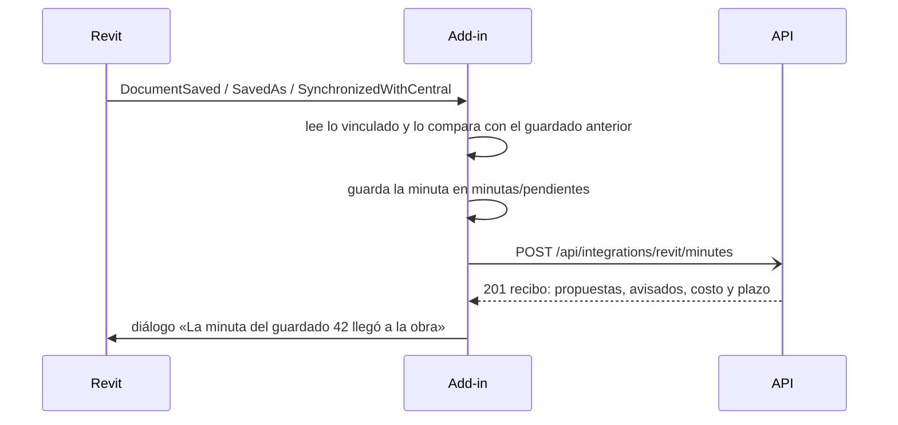
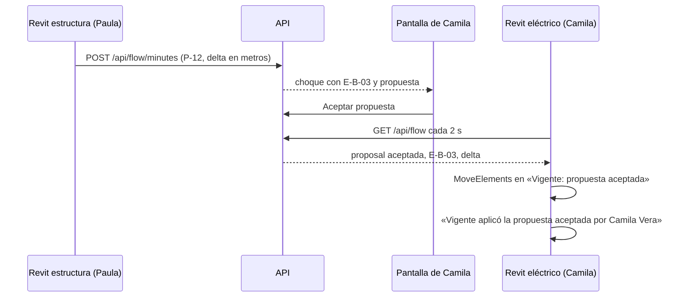

# Add-in de Revit: minuta de cambios

Cada vez que guardas el modelo en Revit, el add-in compara los elementos vinculados a la obra con el guardado anterior, arma la **minuta de cambios** (solo lo que cambió) y la manda a la API. La API la ingiere como una revisión nueva del documento «Modelo Revit de arquitectura», en el Drive del proyecto, y corre la misma cadena que un documento soltado: abre una propuesta por elemento, calcula costo y plazo y avisa solo a los afectados. Revit te muestra el resultado: qué propuestas se abrieron, a quién avisamos, con su costo y su plazo.



- **Solo lo que cambió.** El primer estado se toma al abrir el modelo. Al guardar se lee de nuevo, se compara y ese estado pasa a ser la base del siguiente guardado. Si nada vinculado cambió, no se manda nada.
- **Nada se pierde.** La minuta se escribe en disco antes de enviarla. Si la API no responde, queda pendiente y se reintenta en el siguiente guardado o con «Enviar pendientes», en el mismo orden en que se guardó.
- **Revit no se congela.** El envío corre en segundo plano y el resultado vuelve a Revit por un `ExternalEvent`, cuando Revit está libre.

## Requisitos

- Windows con Revit 2025, 2026 o 2027.
- SDK de .NET 10 (compila las tres versiones; para 2025 y 2026 basta el SDK de .NET 8).
- La API corriendo y alcanzable desde el PC de Revit (`pnpm dev:api`, ver el [README de la API](../../apps/api/README.md)).

## Compilar e instalar

Cierra Revit (tiene tomadas las DLL del add-in) y, desde `tool-use-case/revit`:

```powershell
dotnet build src/Team27.Minuta.Revit -c Release -p:RevitVersion=2026
```

En Windows el build instala el add-in en `%APPDATA%\Autodesk\Revit\Addins\2026`:

| Archivo                                            | Qué es                                                  |
| -------------------------------------------------- | ------------------------------------------------------- |
| `Team27.Minuta.addin`                              | El manifiesto que Revit lee al iniciar                  |
| `Team27.Minuta\Team27.Minuta.Revit.dll`            | El add-in                                               |
| `Team27.Minuta\Team27.Minuta.Core.dll`             | La minuta, el cliente de la API y la cola de pendientes |
| `Team27.Minuta\minuta.config.json`                 | La configuración; si ya existe, el build no la pisa     |

- `-p:RevitVersion=2025`, `2026` o `2027` elige los ensamblados de referencia de Revit (`Nice3point.Revit.Api.*`) y el framework: .NET 8 para 2025 y 2026, .NET 10 para 2027. Cada versión compila en su propia carpeta (`bin/<versión>`, `obj/<versión>`).
- `-p:DeployToRevit=false` compila sin instalar. Para instalar a mano, copia esos cuatro archivos desde `src/Team27.Minuta.Revit/bin/2026/Release/net8.0-windows/` con la misma estructura.
- Al abrir Revit aparece la pestaña **Team 27** con el panel **Minuta de cambios**. Si Revit pregunta si cargar el add-in, elige «Cargar siempre».

## Configuración

`minuta.config.json`, junto a la DLL. Si falta, se usan estos valores. Si tiene un error, Revit te avisa en el primer guardado y sigue con los valores por defecto.

| Clave               | Por defecto                 | Qué es                                                                                                      |
| ------------------- | --------------------------- | ----------------------------------------------------------------------------------------------------------- |
| `apiUrl`            | `http://localhost:3001/api` | Dónde está la API, con el prefijo `/api`                                                                    |
| `webUrl`            | `http://localhost:3000`     | La web, para el botón «Abrir la propuesta en la sala»                                                       |
| `presenterKey`      | `sala-los-aromos`           | La `PRESENTER_KEY` de la API. Hace que la minuta llegue como Fernanda Lagos, dueña del modelo               |
| `subjectParameter`  | `Clave obra`                | El parámetro de texto que dice a qué elemento de la obra corresponde cada elemento de Revit                 |
| `gridName`          | `A`                         | El eje desde el que se mide la distancia del shaft                                                          |
| `sendOnSave`        | `true`                      | Con `false`, la minuta se arma al guardar pero queda pendiente hasta «Enviar pendientes»                    |
| `confirmBeforeSend` | `false`                     | Con `true`, después de guardar te muestra la minuta y pregunta si la envías ahora o más tarde               |
| `showResult`        | `true`                      | Con `false`, solo avisa cuando una minuta falla o la API la rechaza                                         |
| `timeoutSeconds`    | `10`                        | Cuánto espera a la API, de 1 a 120                                                                          |
| `categories`        | ver abajo                   | Las categorías que se leen y a las que se vincula el parámetro (`BuiltInCategory`)                         |
| `subjects`          | los siete de la obra        | La lista de `[{ "id", "name" }]` que ofrece «Vincular»                                                      |

Las categorías por defecto son `OST_Floors`, `OST_Roofs`, `OST_Windows`, `OST_Doors`, `OST_ShaftOpening` y `OST_GenericModel`.

## Qué lee de cada elemento

Un elemento entra en la minuta cuando su parámetro «Clave obra» dice a qué elemento de la obra corresponde. Las claves son las de la API: `losa-n2`, `losa-n3`, `losa-n4`, `losa-n5`, `losa-cubierta`, `shaft-s1` y `ventanas-norte`. El botón «Vincular» crea el parámetro (compartido, de texto, por ejemplar, con un GUID fijo) y lo llena; un parámetro de proyecto con el mismo nombre creado a mano también sirve.

| Valor de la obra               | De dónde sale                                                                                                                                                                                           |
| ------------------------------ | ------------------------------------------------------------------------------------------------------------------------------------------------------------------------------------------------------- |
| `espesor_cm` Espesor           | El espesor del suelo o la cubierta; si no, un parámetro «Espesor», «Grosor» o «Thickness»                                                                                                               |
| `ancho_cm` Ancho               | El ancho de la ventana, la puerta o la familia (del ejemplar o del tipo); si no, un parámetro «Ancho», «Anchura» o «Width»; en un hueco de shaft sin parámetros, el lado menor de su caja en planta |
| `alto_cm` Alto                 | El alto de la ventana, la puerta o la familia; si no, un parámetro «Alto», «Altura» o «Height»                                                                                                          |
| `posicion_m` Distancia al eje A | Un parámetro «Distancia eje A», «Distancia al eje A», «Posición» o «Posicion»; si no, en huecos de shaft y modelos genéricos, la distancia en planta desde su punto de referencia al eje `gridName` |
| `cantidad` Cantidad            | Cuántas ventanas o puertas tienen esa clave                                                                                                                                                             |

- Las longitudes se convierten a cm o m y se redondean como en la API: cm con un decimal, m con dos y la cantidad entera. Así un 15,0000001 cm no es un cambio.
- Si los elementos de una misma clave no coinciden (una ventana distinta de las otras 23), vale el valor que más se repite.

## La minuta

Es un JSON con el modelo, el guardado y los cambios, cada uno con su valor anterior y el nuevo y los elementos de Revit de donde salió. El contrato está en [`contract/`](./contract/): [`minuta.example.json`](./contract/minuta.example.json) es lo que se envía y [`receipt.example.json`](./contract/receipt.example.json) lo que responde la API. Los tests del add-in y de la API leen esos mismos archivos.

- `POST {apiUrl}/integrations/revit/minutes` con `x-presenter-key` y `x-action-id` (el `minuteId`).
- `before: null` es un valor recién vinculado y `after: null` un elemento que ya no está; la API no registra eliminaciones y lo devuelve en `ignored`.
- La API rotula la revisión `guardado <número de guardados del archivo>`; «Publicar estado» manda una minuta sin guardado y se rotula `minuta <primeros 8 del minuteId>`.

| Respuesta                                 | Qué hace el add-in                                                     |
| ----------------------------------------- | ---------------------------------------------------------------------- |
| 201                                       | La mueve a `enviadas` con su recibo y muestra el resultado             |
| 409 `already_ingested`                    | La da por entregada: la obra ya tenía esa revisión                     |
| 400, 403, 422 `minute_empty` y otros 409  | La mueve a `rechazadas` con el motivo y te lo muestra                  |
| 401, 404, 5xx, sin conexión o sin respuesta | La deja pendiente, te dice qué revisar y la reintenta después          |

## El flujo de la muestra: pilar P-12 y bandeja E-B-03

Además de la minuta escalar, el add-in conecta dos modelos de Revit con el [flujo de 4 pasos](../../docs/spec/fuente-de-verdad.md): el modelo de estructura manda el movimiento de un pilar y el modelo eléctrico aplica la propuesta que acepta su dueña.



**Salida (estructura).** Al guardar, el add-in compara la posición (`LocationPoint`) de cada pilar estructural con el guardado anterior. Los pilares se identifican por su Marca (`Mark`, parámetro «Marca»), por ejemplo `P-12`. Un movimiento de al menos 1 mm sale como un cambio `location` con el delta en metros (Revit trabaja en pies; se convierte). La minuta escalar sigue funcionando igual y no se ve afectada.

```
POST {apiUrl}/flow/minutes
x-presenter-key: <presenterKey>
x-act-as: paula-rojas
x-action-id: <minuteId>
```

El cuerpo es [`contract/flow-minute.example.json`](./contract/flow-minute.example.json); un test lo compara con lo que arma el add-in. El `minuteId` es único por minuta y la API es idempotente por él: si la API no responde, la minuta queda pendiente en memoria y se reintenta con el mismo `minuteId` cada vez que corre la consulta (cada 2 s) y en el siguiente guardado.

| Respuesta | Qué hace el add-in |
| --------- | ------------------ |
| 2xx | Muestra «Vigente recibió tu cambio» |
| 401, 404, 5xx, sin conexión | Queda pendiente y reintenta; el motivo va a `minuta.log` |
| 403 | Muestra que el asiento configurado no es dueño del elemento |
| 409 | Muestra que ya hay un cambio abierto: reinicia el caso desde la sala |

**Entrada (eléctrico).** Un temporizador consulta cada `pollSeconds` (2 por defecto) `GET {apiUrl}/flow` con `x-presenter-key` y `x-act-as: camila-vera`. El temporizador solo hace HTTP; todo lo que toca la API de Revit corre en el hilo principal por un `ExternalEvent`. Si `proposal.status` es `aceptada`, `aplicada` o `resuelta`, el delta no es cero y esa propuesta no se aplicó todavía en ese documento, el add-in:

1. busca los elementos del modelo cuya Marca es `proposal.elementId` (por ejemplo `E-B-03`, cualquier categoría);
2. los traslada `proposal.delta` (metros a pies) con `ElementTransformUtils.MoveElements`, en una transacción llamada «Vigente: propuesta aceptada»;
3. actualiza la base de cambios de ese pilar, para que el siguiente guardado no informe el movimiento aplicado como un cambio nuevo;
4. muestra «Vigente aplicó la propuesta aceptada por Camila Vera».

Cada propuesta se aplica una sola vez por modelo: el add-in anota los ids aplicados en `%LOCALAPPDATA%\Team27\Minuta\flow-applied.txt`, así que reabrir Revit no la repite (un reinicio del caso crea otra propuesta con otro id). Si el movimiento falla o ningún elemento tiene esa Marca, avisa una vez, no la anota y no vuelve a insistir sola. El botón **Aplicar propuesta** de la cinta consulta ahora y reintenta las que fallaron.

### Configuración del flujo

En `minuta.config.json`, la sección `flow`. `apiUrl` y `presenterKey` son las de arriba. Cada entrada de `models` liga un modelo, por el título del archivo, con el asiento que actúa:

```json
"flow": {
  "enabled": true,
  "pollSeconds": 2,
  "models": [
    { "titleContains": "_EST", "seat": "paula-rojas", "discipline": "estructura",
      "reason": "Alinear con el muro de corte M-6 y bajar la torsión", "sends": true, "applies": false },
    { "titleContains": "_ELEC", "seat": "camila-vera", "discipline": "electricas",
      "sends": false, "applies": true }
  ]
}
```

| Clave | Qué es |
| ----- | ------ |
| `enabled` | Con `false`, el flujo no se activa |
| `pollSeconds` | Cada cuántos segundos consulta la propuesta, de 1 a 60 |
| `titleContains` | Texto del título del modelo (sin distinguir mayúsculas); gana la primera entrada que calce. `LosAromos_EST.rvt` calza con `_EST` |
| `seat` | El asiento del elenco que actúa (`x-act-as`): quien envía debe ser dueño del elemento |
| `discipline` | La disciplina del modelo que viaja en la minuta |
| `reason` | Motivo que acompaña cada cambio de ese modelo; la API lo exige, así que sin uno sale «Cambio de ubicación hecho en Revit» |
| `sends` / `applies` | Si el modelo envía movimientos de pilares y si aplica propuestas aceptadas (ambos `true` por defecto) |

### Lista para la demo en un PC con Revit

1. API y web corriendo y alcanzables desde Windows (`apiUrl` y `presenterKey` correctos en el `minuta.config.json` instalado).
2. Dos modelos abiertos, `LosAromos_EST.rvt` y `LosAromos_ELEC.rvt` (o dos instancias de Revit). En el de estructura, un pilar estructural con Marca `P-12`; en el eléctrico, una bandeja con Marca `E-B-03`. El add-in solo mira modelos cuyo título calce con `flow.models`.
3. En la sala, caso reiniciado (sin cambio abierto).
4. Estructura: mueve P-12 0,40 m al norte (+Y del modelo) y guarda. Debe salir «Vigente recibió tu cambio: P-12 se movió 0,40 m al norte».
5. Pantalla de Camila: aparece el choque con la propuesta; pulsa «Aceptar propuesta».
6. En unos 2 s, Revit eléctrico muestra «Vigente aplicó la propuesta aceptada por Camila Vera» y E-B-03 se corre 0,40 m al norte; se ve en «Deshacer» como «Vigente: propuesta aceptada».
7. Pantalla de Paula: «Resuelto por Camila Vera a las HH:MM».
8. Guarda el modelo eléctrico: no debe salir ninguna minuta nueva por el movimiento aplicado.

Qué no se probó sin Revit (el build y los tests corren en contenedor): lo que toca la API de Revit, es decir la lectura de Marca y `LocationPoint`, `MoveElements` sobre una bandeja (si está fijada o es de un tipo que no admite traslación, falla y el add-in lo muestra), el `ExternalEvent` y los diálogos; y el viaje HTTP real contra la API del flujo (los tests comparan el JSON con el contrato). Límites: se traslada el elemento completo, no un tramo de 6 m (la bandeja de la demo tiene que ser un elemento corto con esa Marca); el eje Y del modelo debe apuntar al norte del caso.

## Los botones

| Botón             | Qué hace                                                                                                                         |
| ----------------- | -------------------------------------------------------------------------------------------------------------------------------- |
| Vincular          | Asocia la selección (o lo que elijas) a un elemento de la obra, o le quita el vínculo                                            |
| Minuta pendiente  | Muestra lo que enviará el próximo guardado, sin enviar nada                                                                       |
| Enviar pendientes | Reintenta las minutas que no llegaron                                                                                             |
| Publicar estado   | Manda todos los valores vinculados; la obra abre propuestas donde difieran de lo vigente. No cambia la base del próximo guardado |
| Aplicar propuesta | Consulta ya si hay una propuesta aceptada del flujo y la aplica en el modelo que corresponda                                     |

## Preparar un modelo para la muestra

El modelo de Edificio Los Aromos ([la muestra](../../docs/muestra.md#el-proyecto-edificio-los-aromos)) no viene en el repo. Uno mínimo:

1. Niveles 1 a 5 y cubierta, y un eje recto llamado `A`.
2. Una losa (suelo) por nivel, del 2 a la cubierta, con un tipo de 15 cm.
3. Un hueco de shaft de 80 × 120 cm, con su centro a 6 m del eje A, del nivel 1 a la cubierta.
4. 24 ventanas de 120 × 150 cm en la fachada norte, todas del mismo tipo.
5. Vincula cada losa a su clave (`losa-n2` … `losa-cubierta`), el shaft a `shaft-s1` y las 24 ventanas a `ventanas-norte` (selecciona una, clic derecho, «Seleccionar todos los ejemplares», y «Vincular»).
6. Guarda. La primera minuta trae los valores recién vinculados; como coinciden con lo vigente, la obra no abre propuestas y lo dice.

## En la muestra

1. Abre la sala (`/sala`) en el proyector y el modelo en Revit.
2. Cambia la losa del nivel 3 a un tipo de 20 cm y guarda.
3. Revit muestra «La minuta del guardado N llegó a la obra»: +$3.636.500, +1 día, y avisamos a Paula Rojas, Javier Muñoz, Daniela Soto y Marcos Fuentes. En la sala aparece la propuesta de la losa y el ticker dice que Fernanda guardó el modelo en Revit.
4. El shaft a 8,5 m del eje A o las ventanas a 150 cm funcionan igual, con las cifras del [guion](../../docs/muestra.md#el-guion).

Los documentos del catálogo que se ponen al día después de la losa (presupuesto v3, Carta Gantt v5 y EETT-03 rev B) piden el plano E-102 rev C. Después del cambio en Revit, suelta el E-102 rev C desde la carpeta de Fernanda: dice lo mismo que el modelo, así que corrobora la propuesta en vez de abrir otra.

## Carpetas y registro

Todo queda en `%LOCALAPPDATA%\Team27\Minuta`:

| Carpeta                  | Qué guarda                                                        |
| ------------------------ | ----------------------------------------------------------------- |
| `minutas\pendientes`     | Las minutas que todavía no llegan a la API                         |
| `minutas\enviadas`       | Las que llegaron, con su recibo (`.recibo.json`)                   |
| `minutas\rechazadas`     | Las que la API rechazó, con el motivo (`.error.json`)              |
| `minuta.log`             | El registro del add-in: inicio, minutas armadas y errores          |

## Problemas comunes

- **«No pudimos conectar con la API».** Revisa que la API esté arriba y que `apiUrl` apunte a ella desde el PC de Revit. Si la API corre en WSL, `localhost` desde Windows suele llegar; si no, usa la IP de WSL.
- **«La API no reconoce la clave del presentador».** `presenterKey` no coincide con la `PRESENTER_KEY` de la API.
- **Guardé y no pasó nada.** Si nada vinculado cambió desde el guardado anterior, no hay minuta. «Minuta pendiente» muestra qué se enviaría.
- **Un elemento no aparece.** Revisa que su categoría esté en `categories` y que su «Clave obra» sea una de las claves de la obra. Una clave desconocida llega a la API, que la devuelve en `ignored`.
- **El build falla al copiar.** Revit está abierto y tiene tomadas las DLL: ciérralo y compila de nuevo.

## Desarrollo

```
tool-use-case/revit/
├── contract/                       el contrato de la minuta, del recibo y del flujo
├── src/Team27.Minuta.Core/         sin Revit: catálogo, foto del modelo, minuta, JSON, cliente, cola, configuración y textos
├── src/Team27.Minuta.Revit/        el add-in: App (eventos y cinta), ChangeTracker, SnapshotReader, ColumnReader, FlowService, SubjectParameter, comandos y diálogos
└── tests/Team27.Minuta.Core.Tests/ xUnit sobre el Core
```

- Los tests corren con `dotnet test tests/Team27.Minuta.Core.Tests -c Release`. Sin el SDK instalado, con Docker:

  ```sh
  docker run --rm -u "$(id -u):$(id -g)" -e HOME=/tmp -v "$PWD":/src -w /src \
    mcr.microsoft.com/dotnet/sdk:10.0 dotnet test tests/Team27.Minuta.Core.Tests -c Release
  ```

- El add-in compila en Linux para revisar que la API de Revit calce (`EnableWindowsTargeting`), pero solo corre dentro de Revit en Windows.
- Si cambias la forma de la minuta, cambia `contract/` y los dos lados: el test de la API (`apps/api/tests/modules/coordination/revit-minute.spec.ts`) parsea `minuta.example.json`.
- El código no lleva comentarios, igual que el resto del repo.

## Límites

- El repositorio de la obra no registra elementos eliminados: llegan a la minuta, pero la API los ignora.
- La distancia al eje se mide en planta y solo contra ejes rectos.
- Cada clave tiene un solo valor por atributo: el que más se repite entre sus elementos.
- La primera base se toma al abrir el modelo. Un cambio guardado sin el add-in no llega en la minuta; «Publicar estado» lo pone al día.
